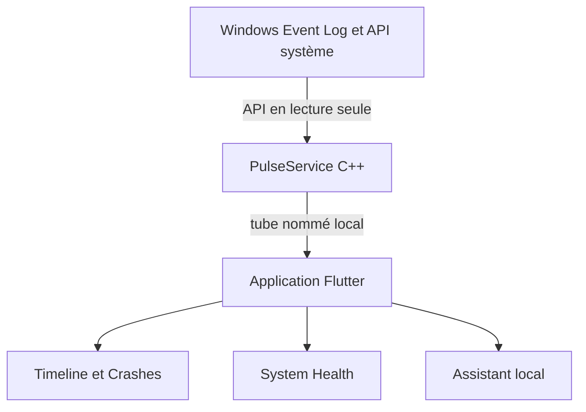

# Regncreative/Pulse

> Read-only Windows application that translates the event log into plain sentences, for users and support.

## The problem
The Windows Event Viewer shows identifiers and XML that few people can read.

## What it actually does
A native C++ service reads the log through the official APIs and a Flutter client displays it as an explained timeline, with crash pages, system health and inventory. Reports can be exported as JSON, CSV, HTML or PDF. An optional assistant queries a local model via Ollama or LM Studio.

## How it is wired
Simplified diagram based on the sheet.


## Trying it
```bash
Get-FileHash .\PulseDiagnostics-Setup-1.6.1-windows-x64.exe -Algorithm SHA256
.\tools\scripts\run_service_console.ps1
.\tools\scripts\run_app.ps1
```

## Cost and gotchas
Free, no account. Windows 10 or 11, 64-bit only. The installer requires UAC elevation and is not yet signed: SmartScreen may warn. Building from source requires Visual Studio, Flutter and Inno Setup.

## What it is not
It is not a cleanup or optimization tool: it never modifies Windows. It does not replace the Event Viewer and does not work outside Windows.

## Alternatives
- Event Viewer: covers all logs, for administrators.
- Reliability Monitor: daily crash history, simpler.

## For you
Ignore for a data / AI / MLOps profile: it is a Windows workstation diagnostic tool, unrelated to your data or model pipelines.
