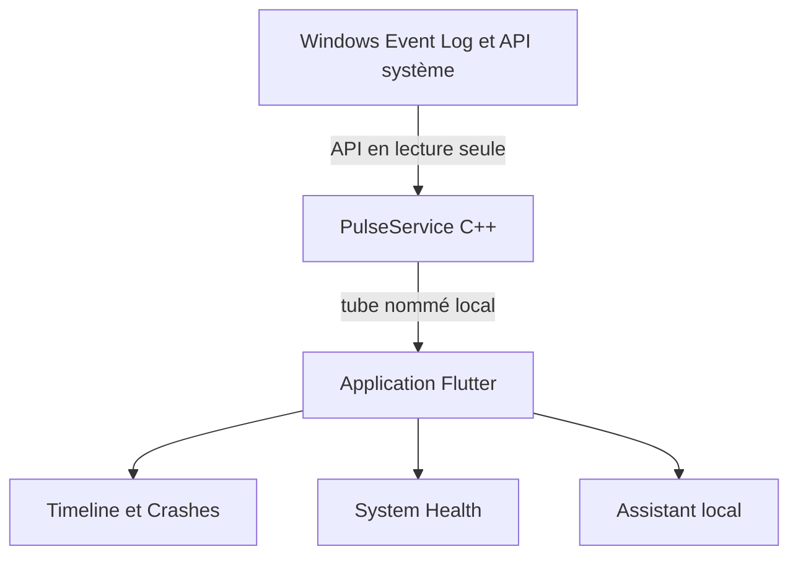

# Regncreative/Pulse

> Application Windows en lecture seule qui traduit le journal d'événements en phrases claires, pour utilisateurs et support.

## Le problème
L'observateur d'événements de Windows affiche des identifiants et du XML que peu de gens savent lire.

## Ce que ça fait vraiment
Un service natif C++ lit le journal par les API officielles et un client Flutter l'affiche en chronologie expliquée, avec pages de plantages, santé du système et inventaire. Les rapports sont exportables en JSON, CSV, HTML ou PDF. Un assistant optionnel interroge un modèle local via Ollama ou LM Studio.

## Comment c'est branché
Schéma simplifié d'après la fiche.


## Essayer
```bash
Get-FileHash .\PulseDiagnostics-Setup-1.6.1-windows-x64.exe -Algorithm SHA256
.\tools\scripts\run_service_console.ps1
.\tools\scripts\run_app.ps1
```

## Coût et pièges
Gratuit, sans compte. Windows 10 ou 11 en 64 bits seulement. L'installeur demande une élévation UAC et n'est pas encore signé : SmartScreen peut alerter. Une compilation depuis les sources demande Visual Studio, Flutter et Inno Setup.

## Ce que ce n'est pas
Ce n'est pas un outil de nettoyage ni d'optimisation : il ne modifie jamais Windows. Il ne remplace pas l'observateur d'événements et ne fonctionne pas hors Windows.

## Alternatives
- Event Viewer : couvre tous les journaux, pour les administrateurs.
- Reliability Monitor : historique quotidien des plantages, plus simple.

## Pour toi
À ignorer pour un profil data / IA / MLOps : c'est un outil de diagnostic poste Windows, sans lien avec tes chaînes de données ou de modèles.

