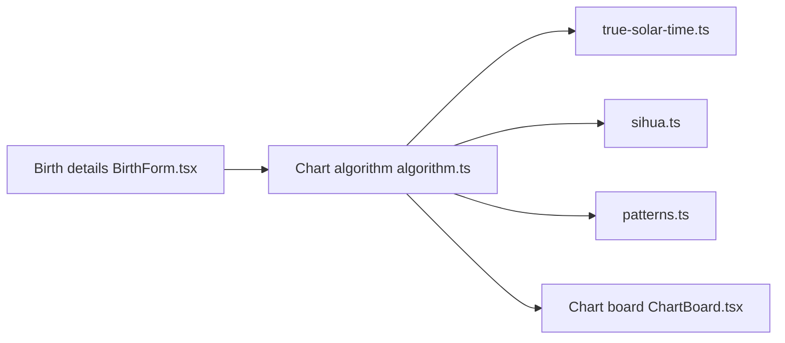

# Renhuai123/ziwei-doushu

> Zi Wei Dou Shu chart-plotting engine and dataset of generated interpretations, in Chinese.

## The problem
Open Chinese astrology engines are incomplete, with no large-scale corpus of interpretations.

## What it actually does
TypeScript engine (`lib/ziwei/`): chart plotting, four transformations, true solar time correction, Chinese daylight saving time, lunar calendar, configuration rules. Release v4.0: 674,976 charts × 13 dimensions, 56.6 GB uncompressed (161 MB compressed), generated deterministically, without AI. Next.js demo with no backend; the statement database and the AI are not open.

## How it is wired


## Trying it
```bash
git clone https://github.com/Renhuai123/ziwei-doushu.git
cd ziwei-doushu
npm install
npm run dev
npm test
zstd -d --long=27 year-1990.jsonl.zst
```

## Cost and gotchas
Free. Data under CC BY 4.0 (attribution), but the Ni Haixia quotations are under CC BY-NC-SA 4.0, non-commercial. The README is in Chinese. v4.0 was generated with the old star brightness setting.

## What it is not
Not an AI interpretation nor a complete product: the interface is a demo, the statement database is closed.

## Alternatives
No alternative named in the README (iztro and lunar-javascript are dependencies).

## For you
Ignore: very domain-specific text corpus; the only plausible use is a Chinese fine-tuning corpus, with the non-commercial caveat on the quotations.
