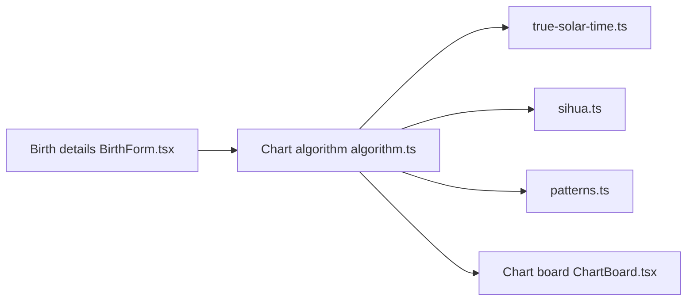

# Renhuai123/ziwei-doushu

> Moteur de tracé de thèmes Zi Wei Dou Shu et jeu de données d'interprétations générées, en chinois.

## Le problème
Les moteurs d'astrologie chinoise ouverts sont incomplets, sans corpus d'interprétations à grande échelle.

## Ce que ça fait vraiment
Moteur TypeScript (`lib/ziwei/`) : tracé du thème, quatre transformations, correction du temps solaire vrai, heure d'été chinoise, calendrier lunaire, règles de configurations. Release v4.0 : 674 976 thèmes × 13 dimensions, 56,6 Go décompressés (161 Mo compressés), générés de façon déterministe, sans IA. Démo Next.js sans backend ; la base d'énoncés et l'IA ne sont pas ouvertes.

## Comment c'est branché


## Essayer
```bash
git clone https://github.com/Renhuai123/ziwei-doushu.git
cd ziwei-doushu
npm install
npm run dev
npm test
zstd -d --long=27 year-1990.jsonl.zst
```

## Coût et pièges
Gratuit. Données en CC BY 4.0 (attribution), mais les citations de Ni Haixia sont en CC BY-NC-SA 4.0, non commercial. Le README est en chinois. La v4.0 a été générée avec l'ancien réglage d'éclat des étoiles.

## Ce que ce n'est pas
Pas une interprétation par IA ni un produit complet : l'interface est une démo, la base d'énoncés est fermée.

## Alternatives
Aucune alternative nommée dans le README (iztro et lunar-javascript sont des dépendances).

## Pour toi
À ignorer : corpus textuel de domaine très spécifique ; seul usage plausible, un corpus de fine-tuning en chinois, avec la réserve non commerciale sur les citations.

