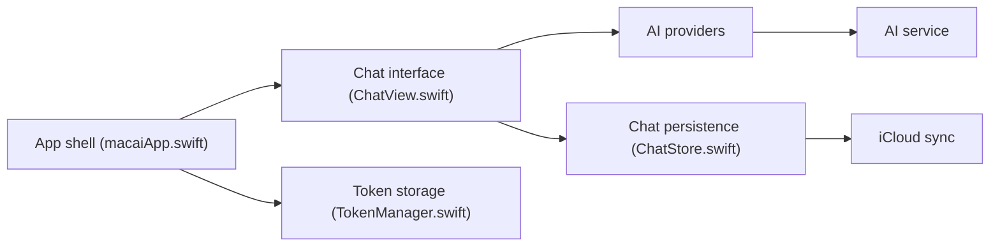

# Renset/macai

> Native AI chat client for macOS, compatible with most LLM providers.

## The problem
Using several LLM providers through scattered web interfaces, with no lightweight native client on the Mac.

## What it actually does
A SwiftUI app: it configures API services (OpenAI, Claude, xAI, Gemini, Perplexity, Ollama, OpenRouter, any OpenAI-compatible endpoint), personas, attachments, import/export and optional iCloud sync. Conversations are stored locally (Core Data). The README announces vision, image generation, search and reasoning without detail.

## How it is wired


## Trying it
```bash
brew install --cask macai
ollama pull <model>
```

## Cost and gotchas
Free; calls to commercial APIs are billed by the provider (key required). With Ollama, everything stays local. Without an Apple developer account, you can build it without iCloud. macOS 14+.

## What it is not
Not an agent or a development tool: a chat client. No telemetry from macai, but Apple may collect some with iCloud.

## Alternatives
No alternative named in the README.

## For you
Worth watching: handy if you juggle several models and Ollama on a Mac; otherwise a web interface is enough.
