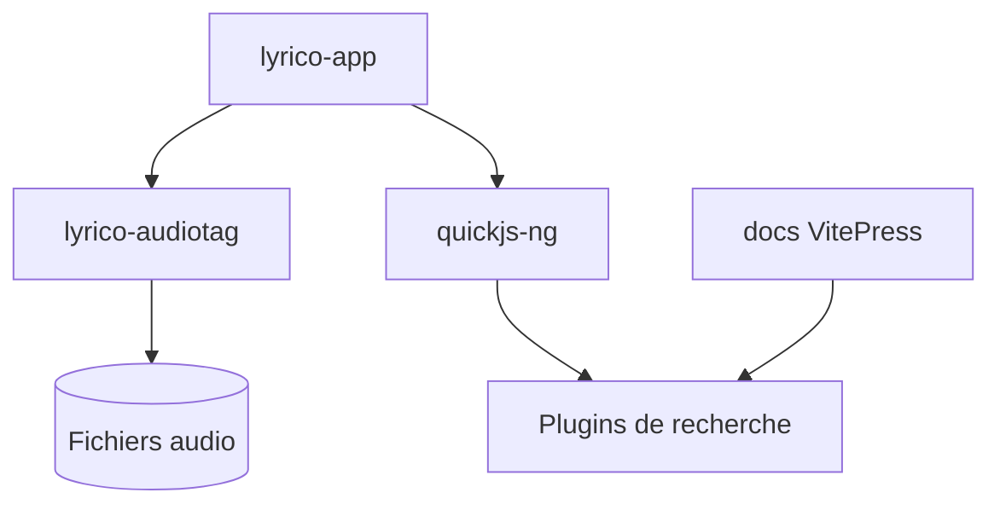

# Replica0110/Lyrico

> Android application to edit local music tags and fill in lyrics and cover art through plugins.

## The problem
A local music library often has missing or wrong tags, lyrics and cover art.

## What it actually does
Scans files, reads and writes metadata (TagLib: MP3, FLAC, OGG, M4A, WAV, APE), handles LRC, word-by-word lyrics and TTML. Batch processing: renaming, loudness analysis. Online search goes through JavaScript plugins run in quickjs-ng. Two interfaces, Miuix and SaltUI. README in Chinese.

## How it is wired
Simplified diagram based on the fiche, no diagram provided.


## Trying it
```powershell
git submodule update --init --recursive
.\gradlew.bat :lyrico-app:assembleDebug
```
Build prerequisites: JDK 21, Android SDK and NDK 29, CMake 4.1.2.

## Cost and gotchas
Free. Online search depends on third-party plugins. The maintainer states that development follows their own needs and that very specific requests may be declined.

## What it is not
Not a music player. Plugins are not provided by the application. The README does not say where to download a binary.

## Alternatives
- LDDC: lyrics download and matching tool cited as a reference.

## For you
Ignore: music tag tool on Android, outside the data / AI / MLOps scope.
