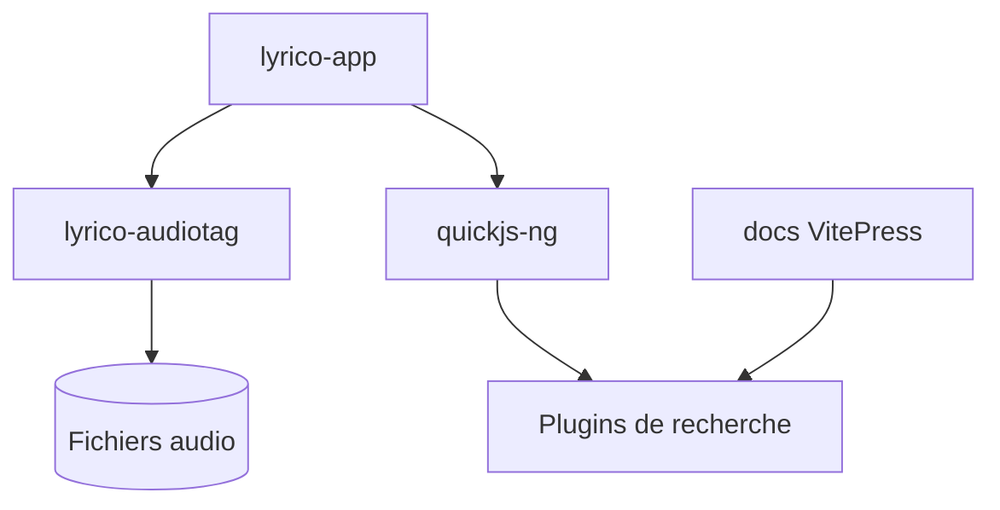

# Replica0110/Lyrico

> Application Android pour éditer les tags musicaux locaux et compléter paroles et pochettes par plugins.

## Le problème
Une bibliothèque musicale locale a souvent des tags, paroles et pochettes manquants ou faux.

## Ce que ça fait vraiment
Scanne les fichiers, lit et écrit les métadonnées (TagLib : MP3, FLAC, OGG, M4A, WAV, APE), gère LRC, paroles mot à mot et TTML. Traitement par lots : renommage, analyse de volume. La recherche en ligne passe par des plugins JavaScript exécutés dans quickjs-ng. Deux interfaces, Miuix et SaltUI. README en chinois.

## Comment c'est branché
Schéma simplifié d'après la fiche, sans diagramme fourni.


## Essayer
```powershell
git submodule update --init --recursive
.\gradlew.bat :lyrico-app:assembleDebug
```
Prérequis de build : JDK 21, SDK et NDK 29 Android, CMake 4.1.2.

## Coût et pièges
Gratuit. La recherche en ligne dépend de plugins tiers. Le mainteneur indique que le développement suit ses besoins et que les demandes très spécifiques peuvent être refusées.

## Ce que ce n'est pas
Pas un lecteur de musique. Les plugins ne sont pas fournis par l'application. Le README ne dit pas où télécharger un binaire.

## Alternatives
- LDDC : outil de téléchargement et d'appariement de paroles cité en référence.

## Pour toi
À ignorer : outil de tags musicaux sur Android, hors du champ data / IA / MLOps.

