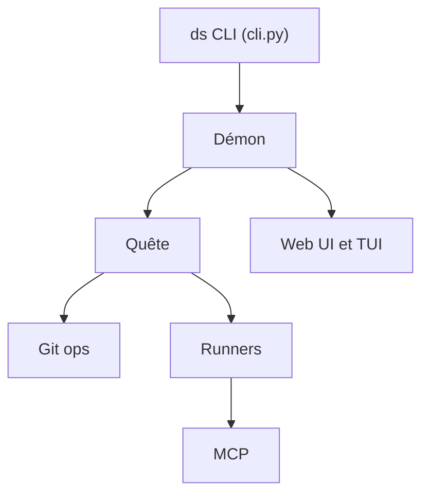

# ResearAI/DeepScientist

> Local autonomous research workshop that drives coding CLIs to reproduce papers and run experiments.

## The problem
Reproducing baselines, chaining experiments and writing up results is scattered across terminals, notes and tools.

## What it actually does
Each "quest" is a local Git repository. A Python daemon (`ds`) drives runners (Codex, Claude Code, Kimi Code, OpenCode) that do the work; memory, branches and artifacts accumulate. Web interface, TUI, messaging connectors (Telegram, Feishu, WhatsApp...). A human can take over at any time.

## How it is wired


## Trying it
```bash
npm install -g @researai/deepscientist
codex login
ds --here
```

## Cost and gotchas
You need one of the coding CLIs already authenticated: model costs remain on you. Linux and macOS supported, Windows experimental. The README announces thousands of experiment validations: the bill can climb.

## What it is not
Not a chatbot nor a single-purpose agent. Not a cloud: everything runs on your machine. Results are not guaranteed, and the roadmap promises even less hallucination.

## Alternatives
- AI-Scientist and AI-Scientist-v2: end-to-end pipeline, without a research map.
- Agent Laboratory: another open end-to-end system.
- RD-Agent: another open system, more targeted.

## For you
Watch: close to your line of work (reproducible experiments, tracking), but young and dependent on external models whose cost is unpredictable.
