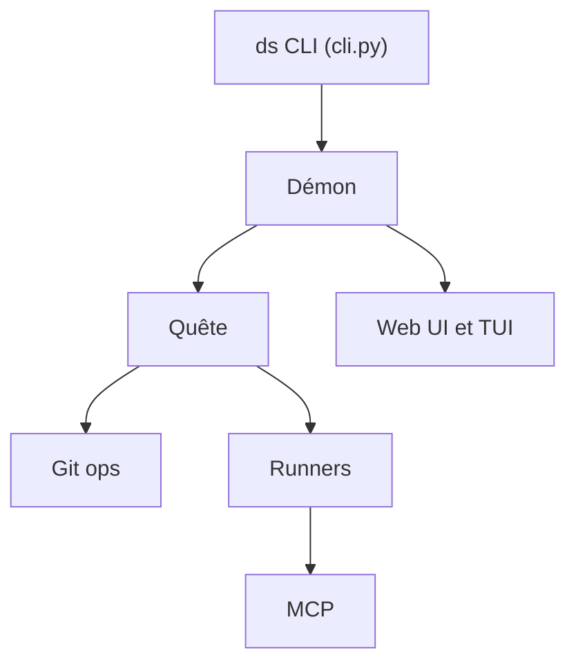

# ResearAI/DeepScientist

> Atelier de recherche autonome en local qui pilote des CLI de code pour reproduire des articles et lancer des expériences.

## Le problème
Reproduire des baselines, enchaîner des expériences et rédiger des résultats se disperse entre terminaux, notes et outils.

## Ce que ça fait vraiment
Chaque « quête » est un dépôt Git local. Un démon Python (`ds`) pilote des runners (Codex, Claude Code, Kimi Code, OpenCode) qui exécutent le travail ; mémoire, branches et artefacts s'accumulent. Interface web, TUI, connecteurs de messagerie (Telegram, Feishu, WhatsApp...). Reprise humaine à tout moment.

## Comment c'est branché


## Essayer
```bash
npm install -g @researai/deepscientist
codex login
ds --here
```

## Coût et pièges
Il faut un des CLI de code déjà authentifié : le coût des modèles reste à ta charge. Linux et macOS pris en charge, Windows expérimental. Le README annonce des milliers de validations d'expériences : la facture peut monter.

## Ce que ce n'est pas
Pas un chatbot ni un agent à usage unique. Pas un cloud : tout tourne chez toi. Les résultats ne sont pas garantis, la feuille de route promet encore moins d'hallucination.

## Alternatives
- AI-Scientist et AI-Scientist-v2 : pipeline de bout en bout, sans carte de recherche.
- Agent Laboratory : autre système ouvert de bout en bout.
- RD-Agent : autre système ouvert, plus ciblé.

## Pour toi
Surveiller : proche de ton métier (expériences reproductibles, suivi), mais jeune et dépendant de modèles externes dont le coût est imprévisible.

