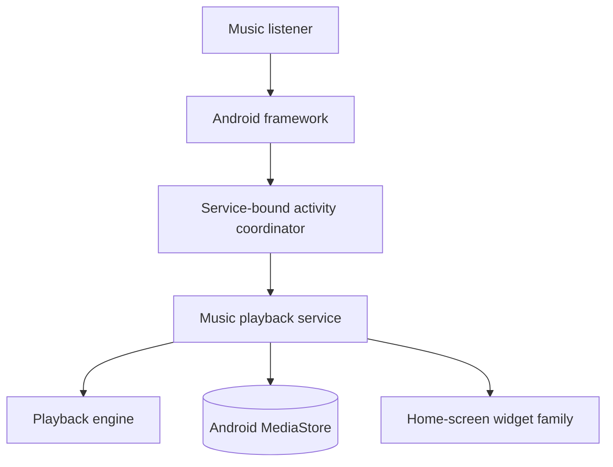

# RetroMusicPlayer/RetroMusicPlayer

> Android music player with a Material You design, for music lovers who listen to their local files.

## The problem
Default Android players offer few themes and settings for a local library.

## What it actually does
Local music player with more than ten playback themes, three main themes, synced lyrics, sleep timer, tag editor, smart playlists, widgets, driving mode, Android Auto and Chromecast. A playback service holds the queue and broadcasts state to the screens. It plays the device's music, not streaming. More than 30 languages.

## How it is wired

## Trying it
The README gives no command: install from the Play Store, F-Droid, Obtainium or the GitHub releases.

## Cost and gotchas
Free. GPL-3.0 license. Artist metadata goes through Deezer and Last.fm clients.

## What it is not
Not a streaming service nor a work tool: it is a local file player on Android.

## Alternatives
No alternative named in the README.

## For you
Ignore: a consumer application unrelated to data, AI or MLOps work.
