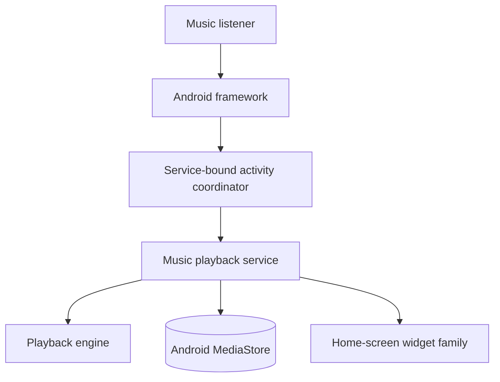

# RetroMusicPlayer/RetroMusicPlayer

> Lecteur de musique Android au design Material You, pour mélomanes qui écoutent leurs fichiers locaux.

## Le problème
Les lecteurs Android par défaut offrent peu de thèmes et de réglages pour une bibliothèque locale.

## Ce que ça fait vraiment
Lecteur de musique locale avec plus de dix thèmes de lecture, trois thèmes principaux, paroles synchronisées, minuteur de sommeil, éditeur de tags, listes de lecture intelligentes, widgets, mode conduite, Android Auto et Chromecast. Un service de lecture tient la file et diffuse l'état aux écrans. Il lit la musique de l'appareil, pas du streaming. Plus de 30 langues.

## Comment c'est branché

## Essayer
Le README ne donne pas de commande : installation depuis Play Store, F-Droid, Obtainium ou les releases GitHub.

## Coût et pièges
Gratuit. Licence GPL-3.0. Les métadonnées d'artistes passent par des clients Deezer et Last.fm.

## Ce que ce n'est pas
Pas un service de streaming ni un outil de travail : c'est un lecteur de fichiers locaux sur Android.

## Alternatives
Aucune alternative nommée dans le README.

## Pour toi
À ignorer : application grand public sans rapport avec les métiers data, IA ou MLOps.

