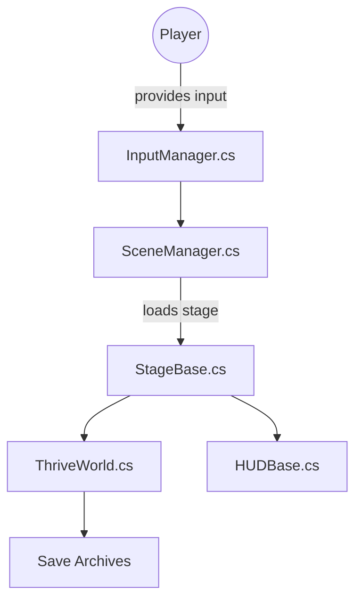

# Revolutionary-Games/Thrive

> Sandbox evolution game written in C# with Godot, for players and volunteer contributors.

## The problem
There is no free game simulating the evolution of species, from the cell to civilization.

## What it actually does
The repository contains the game: C# code and Godot scenes in `src/`, assets under Git LFS, simulation parameters in JSON, helper scripts and tests. According to the architecture, the microbe, awakening, society and ascension stages share a scene manager, a simulated world, an automatic evolution module, saves, mods and Steam achievements.

## How it is wired


## Trying it
```bash
dotnet run --project Scripts -- help
```
The only command in the README: the helper scripts. Building the game follows `doc/setup_instructions.md`, with Godot and Git LFS.

## Cost and gotchas
Free. You need Godot, the .NET SDK and Git LFS to fetch the assets. The graphs and dependencies come from reading the directory tree only; some paths are unverified.

## What it is not
Not a work tool: it is a game. A license is present but not identified by GitHub; read it before reusing code or assets. No tests for the Godot version according to the README.

## Alternatives
No alternative named in the README.

## For you
Ignore: a C# game unrelated to the data / AI / MLOps trade; its only value is as an example of a large Godot project.
