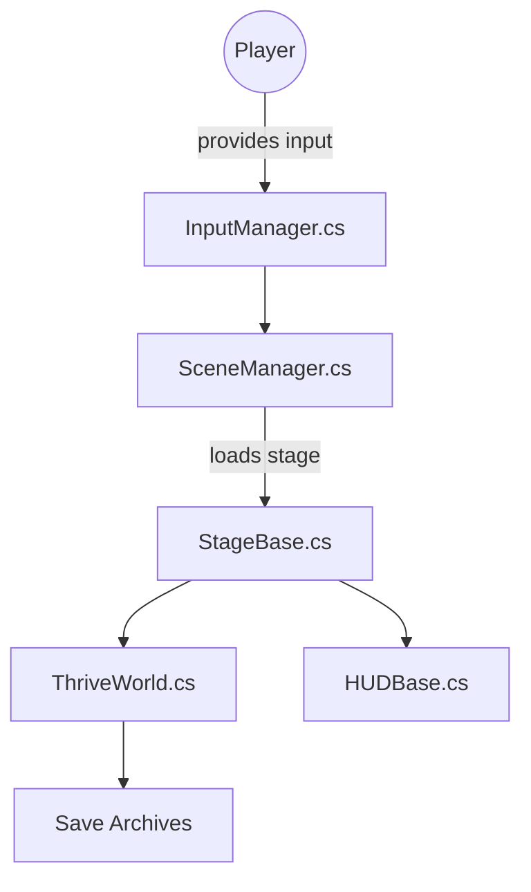

# Revolutionary-Games/Thrive

> Jeu d'évolution en bac à sable, écrit en C# avec Godot, pour joueurs et contributeurs bénévoles.

## Le problème
Il manque un jeu libre simulant l'évolution des espèces, de la cellule jusqu'à la civilisation.

## Ce que ça fait vraiment
Le dépôt contient le jeu : code C# et scènes Godot dans `src/`, assets sous Git LFS, paramètres de simulation en JSON, scripts d'aide et tests. D'après l'architecture, les étapes microbe, éveil, société et ascension partagent un gestionnaire de scènes, un monde simulé, un module d'évolution automatique, des sauvegardes, des mods et des succès Steam.

## Comment c'est branché


## Essayer
```bash
dotnet run --project Scripts -- help
```
Seule commande du README : les scripts d'aide. La compilation du jeu suit `doc/setup_instructions.md`, avec Godot et Git LFS.

## Coût et pièges
Gratuit. Il faut Godot, le SDK .NET et Git LFS pour récupérer les assets. Les graphes et dépendances viennent d'une lecture de l'arborescence seulement, certains chemins ne sont pas vérifiés.

## Ce que ce n'est pas
Pas un outil de travail : c'est un jeu. Licence présente mais non identifiée par GitHub, à lire avant de réutiliser du code ou des assets. Pas de tests pour la version Godot d'après le README.

## Alternatives
Aucune alternative nommée dans le README.

## Pour toi
À ignorer : un jeu en C# sans rapport avec le métier data / IA / MLOps ; sa seule valeur est comme exemple de gros projet Godot.

