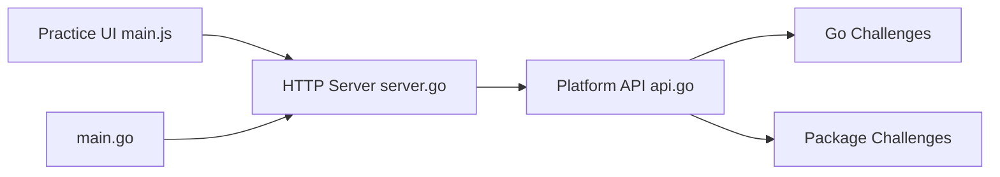

# RezaSi/go-interview-practice

> Go exercise platform with automated tests, leaderboards and AI feedback, to prepare for interviews.

## The problem
Learning Go for technical interviews requires tested exercises and feedback on your solution.

## What it actually does
30 challenges (beginner to advanced) and 26 per-package challenges (cobra, echo, fiber, gin, gorm, mongodb). A Go web interface runs the tests, measures time and memory, and updates leaderboards and badges through GitHub Actions. Optional AI interview simulation (Gemini, OpenAI or Claude).

## How it is wired


## Trying it
```bash
git clone https://github.com/yourusername/go-interview-practice.git
cd go-interview-practice/web-ui
go run main.go
./create_submission.sh 1
cd challenge-1 && ./run_tests.sh
```

## Cost and gotchas
Free; fork required before cloning. A Gemini key (free tier cited) for the AI features. A hosted version exists at app.gointerview.dev.

## What it is not
Not a Go course: these are exercises. The license is not identified by GitHub.

## Alternatives
No alternative named in the README.

## For you
Ignore: only useful if you are preparing for Go interviews, not for a Python data/AI/MLOps profile.
