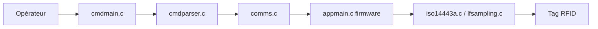

# RfidResearchGroup/proxmark3

> Firmware and client for the "Iceman" Proxmark3, an RFID analysis tool for enthusiasts and pentesters.

## The problem
Analyzing, reading or emulating low- and high-frequency RFID badges requires dedicated hardware and software.

## What it actually does
The command-line client (HF/LF commands, Python and Lua scripts) talks to the device firmware, which interacts with the tags. Standalone modes are documented. Supported hardware: RDV4, RDV1-3, SE, X, generic; the Proxmark5 is flagged as unstable. The README warns of frequent changes to the code structure.

## How it is wired


## Trying it
```bash
./pm3-flash-all
./pm3
```

## Cost and gotchas
You have to buy a compatible Proxmark, then compile. On boards with 256 KB of flash, features must be reduced at compile time.

## What it is not
Not standalone software: useless without the hardware. Several clones are "unsupported" or of unknown status.

## Alternatives
No alternative named in the README.

## For you
Ignore: physical security unrelated to data/AI/MLOps, unless you have a dedicated mission.
