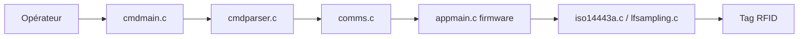

# RfidResearchGroup/proxmark3

> Firmware et client du Proxmark3 « Iceman », outil d'analyse RFID pour passionnés et pentesters.

## Le problème
Analyser, lire ou émuler des badges RFID basse et haute fréquence demande un matériel et un logiciel dédiés.

## Ce que ça fait vraiment
Le client en ligne de commande (commandes HF/LF, scripts Python et Lua) dialogue avec le firmware du dispositif, qui interagit avec les tags. Modes autonomes documentés. Matériel pris en charge : RDV4, RDV1-3, SE, X, génériques ; le Proxmark5 est signalé comme instable. Le README prévient de changements fréquents de structure du code.

## Comment c'est branché


## Essayer
```bash
./pm3-flash-all
./pm3
```

## Coût et pièges
Il faut acheter un Proxmark compatible, puis compiler. Sur les cartes à 256 Ko de flash, il faut réduire les fonctionnalités à la compilation.

## Ce que ce n'est pas
Pas un logiciel autonome : sans le matériel il ne sert à rien. Plusieurs clones sont « non supportés » ou d'état inconnu.

## Alternatives
Aucune alternative nommée dans le README.

## Pour toi
À ignorer : sécurité physique sans lien avec data/IA/MLOps, sauf mission dédiée.

