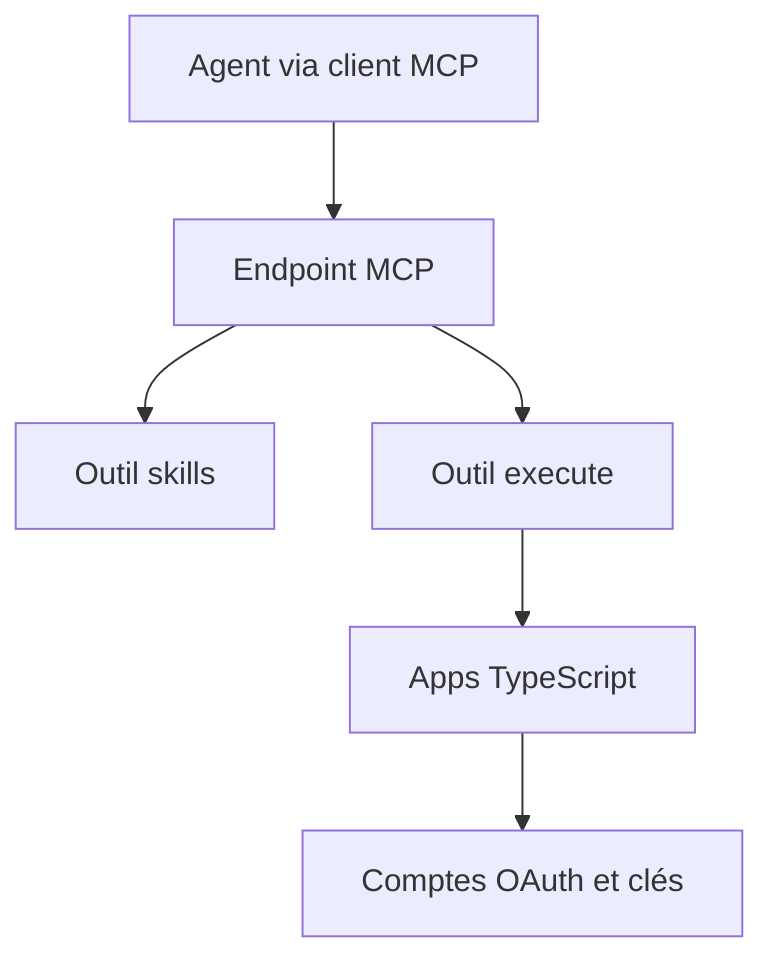

# RhysSullivan/executor

> Layer that exposes accounts and APIs to your agents through a single MCP endpoint, without showing them the credentials.

## The problem
Each agent client requires pasting the same keys again and rewiring the same servers, with no control over risky actions.

## What it actually does
An "app" is a small TypeScript program that turns accounts into tools (OpenAPI specification, remote MCP server, manual call). The agent only has two tools, `skills` and `execute`, and writes code that runs across several apps. Each tool decides on an approval: always, never, or if the input looks risky.

## How it is wired
Simplified diagram based on the sheet, no diagram provided.



## Trying it
```sh
curl -fsSL https://executor.sh/docs/install.sh | sh
executor
claude mcp add --transport http --scope user executor 'https://mcp.executor.sh/mcp'
```

## Cost and gotchas
Three modes: hosted (account on app.executor.sh), local or Docker container. Pricing details are not in the README. The hosted path entrusts your accounts to a third party.

## What it is not
It is not just a directory of MCP servers: it is a code execution environment. It does not replace your agent clients, it sits behind them.

## Alternatives
Zapier and Retool, cited in the README as points of comparison for automation.

## For you
Keep an eye on it: the idea of never exposing credentials to the agent is solid for agentic MLOps, but the project is young and run by a single person.
