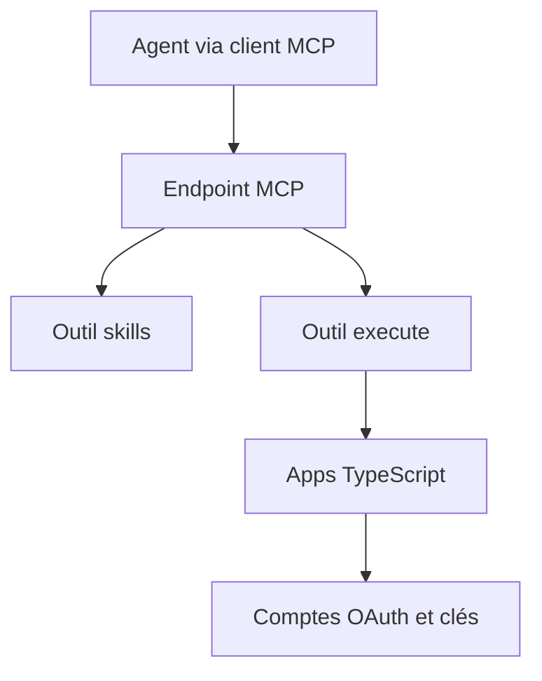

# RhysSullivan/executor

> Couche qui expose comptes et API à tes agents via un seul endpoint MCP, sans leur montrer les identifiants.

## Le problème
Chaque client d'agent demande de recoller les mêmes clés et de recâbler les mêmes serveurs, sans contrôle des actions risquées.

## Ce que ça fait vraiment
Une « app » est un petit programme TypeScript qui transforme des comptes en outils (spécification OpenAPI, serveur MCP distant, appel manuel). L'agent ne dispose que de deux outils, `skills` et `execute`, et écrit du code qui s'exécute sur plusieurs apps. Chaque outil décide d'une approbation : toujours, jamais, ou si l'entrée semble risquée.

## Comment c'est branché
Schéma simplifié d'après la fiche, sans diagramme fourni.



## Essayer
```sh
curl -fsSL https://executor.sh/docs/install.sh | sh
executor
claude mcp add --transport http --scope user executor 'https://mcp.executor.sh/mcp'
```

## Coût et pièges
Trois modes : hébergé (compte sur app.executor.sh), local ou conteneur Docker. Le détail des tarifs n'est pas dans le README. Le chemin hébergé confie tes comptes à un tiers.

## Ce que ce n'est pas
Ce n'est pas un simple annuaire de serveurs MCP : c'est un environnement d'exécution de code. Il remplace pas tes clients d'agent, il se place derrière eux.

## Alternatives
Zapier et Retool, cités dans le README comme points de comparaison pour l'automatisation.

## Pour toi
Surveiller : l'idée de ne jamais exposer les identifiants à l'agent est solide pour du MLOps agentique, mais le projet est jeune et porté par une seule personne.

