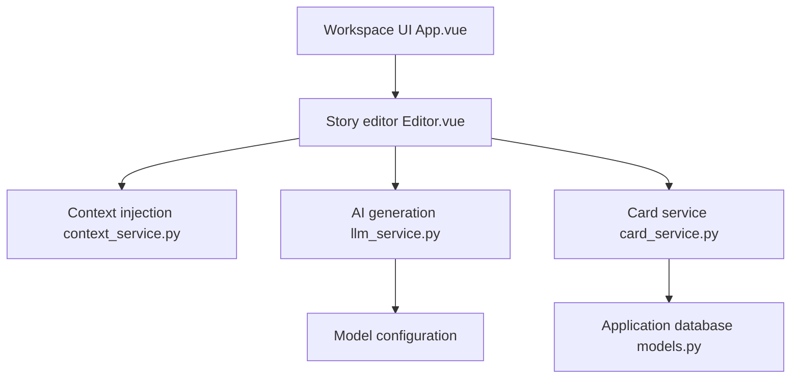

# RhythmicWave/NovelForge

> AI-assisted writing tool for very long novels, based on structured cards and a relationship graph.

## The problem
A novel of several million characters loses coherence and control when the AI generates without the project's context.

## What it actually does
JSON-schema cards, filled in field by field as a stream with feedback from the author. `@DSL` references inject project data into the prompts. A relationship graph (SQLite, Neo4j optional) keeps things consistent. An inspiration assistant, a workflow system in code and a proofreading module complete the whole. Electron and Vue interface, FastAPI backend.

## How it is wired


## Trying it
```bash
git clone https://github.com/RhythmicWave/NovelForge.git
cd NovelForge/backend
pip install -r requirements.txt
python main.py
cd ../frontend && npm install && npm run dev
```

## Cost and gotchas
A model API key is required, added in the settings. The word-count control mode consumes more tokens. The README recommends a Gemini 2.5 Pro level. Old databases may not migrate from v0.9.0.

## What it is not
Not a free tool for hosting a service: the README requires a commercial license from the author for SaaS use. Documentation in Chinese.

## Alternatives
No alternative named in the README.

## For you
Ignore: a fiction-writing tool, far from data, AI or MLOps work, with an AGPL license that has a commercial clause.
