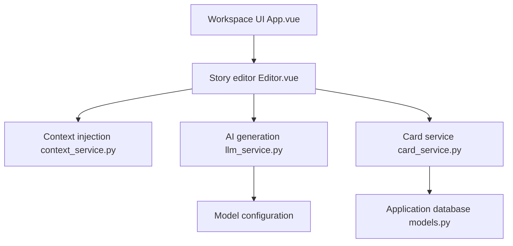

# RhythmicWave/NovelForge

> Outil d'écriture assistée par IA pour romans très longs, fondé sur des cartes structurées et un graphe de relations.

## Le problème
Un roman de plusieurs millions de caractères perd en cohérence et en contrôle quand l'IA génère sans contexte du projet.

## Ce que ça fait vraiment
Des cartes à schéma JSON, remplies champ par champ en flux avec retour de l'auteur. Des références `@DSL` injectent les données du projet dans les prompts. Un graphe de relations (SQLite, Neo4j en option) garde la cohérence. Un assistant d'inspiration, un système de workflows en code et un module de relecture complètent l'ensemble. Interface Electron et Vue, backend FastAPI.

## Comment c'est branché


## Essayer
```bash
git clone https://github.com/RhythmicWave/NovelForge.git
cd NovelForge/backend
pip install -r requirements.txt
python main.py
cd ../frontend && npm install && npm run dev
```

## Coût et pièges
Il faut une clé d'API de modèle, ajoutée dans les réglages. Le mode de contrôle du nombre de mots consomme plus de tokens. Le README recommande un niveau Gemini 2.5 Pro. Les anciennes bases peuvent ne pas migrer depuis la v0.9.0.

## Ce que ce n'est pas
Pas un outil gratuit pour héberger un service : le README exige une licence commerciale auprès de l'auteur pour un usage SaaS. Documentation en chinois.

## Alternatives
Aucune alternative nommée dans le README.

## Pour toi
À ignorer : un outil d'écriture de fiction, éloigné d'un travail data, IA ou MLOps, avec une licence AGPL à clause commerciale.

