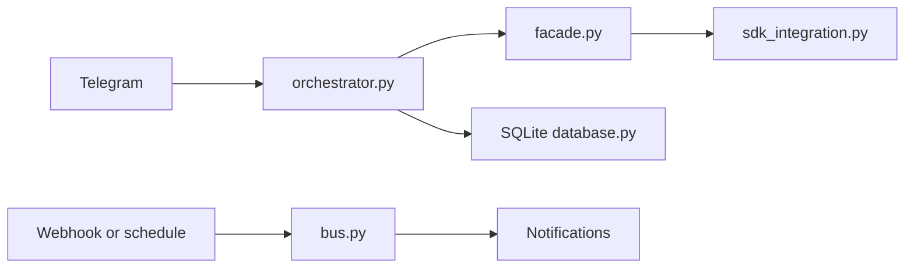

# RichardAtCT/claude-code-telegram

> Telegram bot that gives remote access to Claude Code to chat about your projects from a phone.

## The problem
Using Claude Code means staying in front of a terminal; you want to trigger or follow code work from anywhere.

## What it actually does
Receives Telegram messages and forwards them to Claude (SDK as primary, CLI as fallback), keeping one session per user and per project in SQLite. Two modes: agentic (conversational) and classic (13 commands). Adds GitHub webhooks, scheduled tasks (cron), notifications, file and image sending, voice transcription, cost tracking, user allowlist, directory sandbox, rate limiting and an audit log.

## How it is wired


## Trying it
```bash
uv tool install git+https://github.com/overwirehq/claude-code-telegram@v1.3.0
cp .env.example .env
make run
```

## Cost and gotchas
Telegram token via @BotFather, Claude Code CLI, optionally `ANTHROPIC_API_KEY`. Adjustable per-user cost limit (`CLAUDE_MAX_COST_PER_USER`). The bot can run commands on the machine: keep the allowlist strict.

## What it is not
Not an autonomous agent to leave open. No license declared: usage and reuse are not clarified. Plugin system only "planned". The README points to an `overwirehq` repository, distinct from the cataloged owner.

## Alternatives
No alternative named in the README.

## For you
Worth watching: handy for driving your agent from mobile, but with no license and remote code execution, only try it in an isolated environment.
