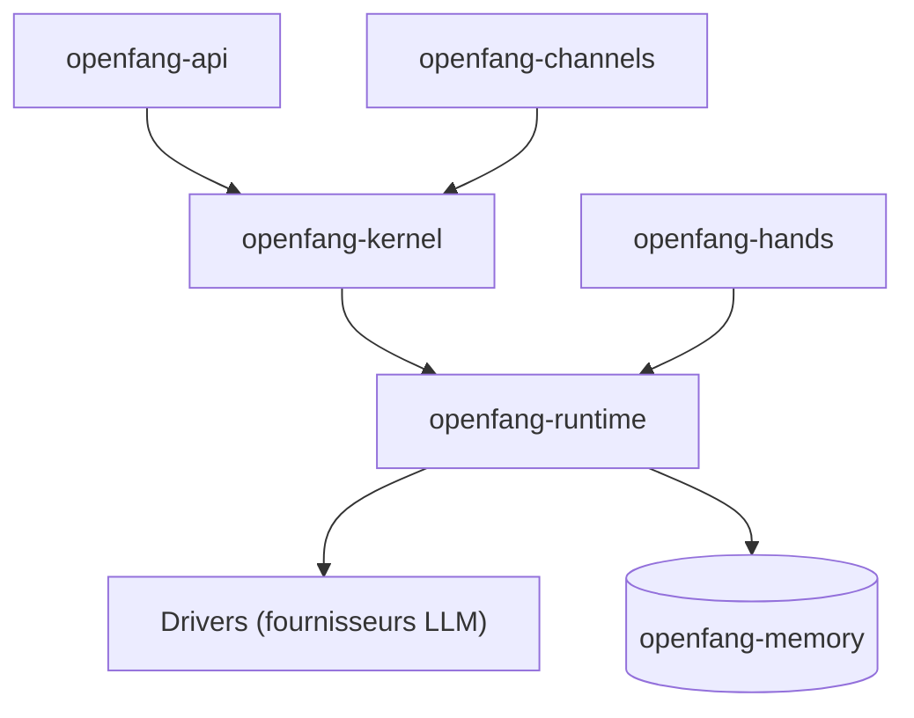

# RightNow-AI/openfang

> Agent operating system in Rust: scheduled autonomous agents, 40 messaging channels, a single binary.

## The problem
Agent frameworks wait for an instruction; recurring tasks (monitoring, prospecting) need scheduling and guardrails.

## What it actually does
A Rust binary with an orchestration kernel, an agent runtime (27 LLM providers, MCP, A2A), SQLite and vector memory, an OpenAI-compatible REST API and a dashboard. The "Hands" are packages of scheduled autonomous agents (Researcher, Lead, Collector, Clip, Twitter, Browser). The README claims 16 layers of security and a WASM sandbox; the comparison figures are the author's own. The project is still pre-1.0.

## How it is wired


## Trying it
```bash
curl -fsSL https://openfang.sh/install | sh
openfang init
openfang start
openfang hand activate researcher
```

## Cost and gotchas
Model provider keys are at your expense. Breaking changes may appear between minor versions; you need to pin a commit. The last push dates from July 2026. The WhatsApp web gateway requires Node 18 or later.

## What it is not
Not a battle-tested tool: the README admits edge cases and some Hands being more mature than others. The comparison benchmarks come from public documentation, not from independent measurements.

## Alternatives
- OpenClaw: the README offers a direct migration from it.
- ZeroClaw: compared as lighter at startup.
- LangGraph, CrewAI, AutoGen: Python frameworks compared in the README.

## For you
Worth watching: an interesting approach to scheduled agents with guardrails, but young, pre-1.0, and to be tested before any trust.
