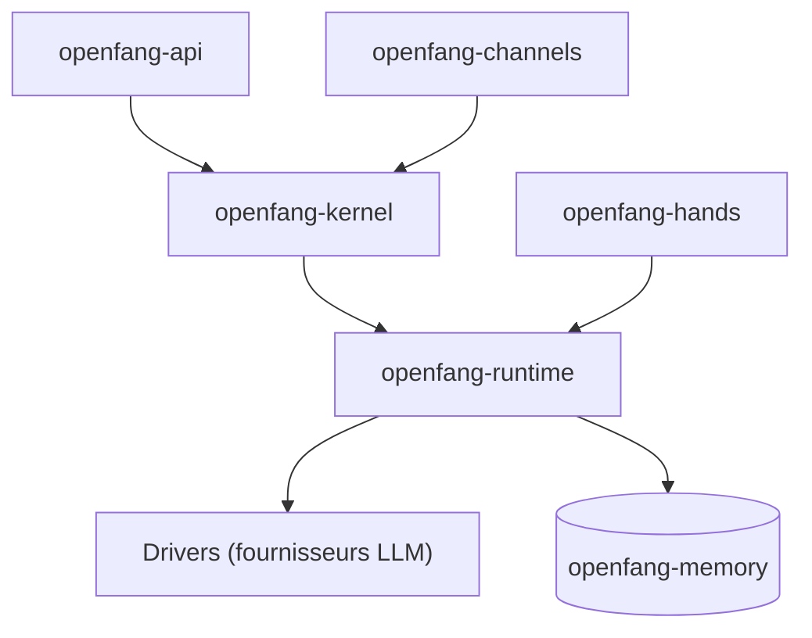

# RightNow-AI/openfang

> Système d'exploitation d'agents en Rust : agents autonomes planifiés, 40 canaux de messagerie, un seul binaire.

## Le problème
Les frameworks d'agents attendent une consigne ; les tâches récurrentes (veille, prospection) demandent de l'ordonnancement et des garde-fous.

## Ce que ça fait vraiment
Un binaire Rust avec noyau d'orchestration, runtime d'agents (27 fournisseurs de LLM, MCP, A2A), mémoire SQLite et vecteurs, API REST compatible OpenAI et tableau de bord. Les « Hands » sont des paquets d'agents autonomes planifiés (Researcher, Lead, Collector, Clip, Twitter, Browser). Le README annonce 16 couches de sécurité et un bac à sable WASM ; les chiffres de comparaison sont de l'auteur. Le projet reste avant 1.0.

## Comment c'est branché


## Essayer
```bash
curl -fsSL https://openfang.sh/install | sh
openfang init
openfang start
openfang hand activate researcher
```

## Coût et pièges
Clés des fournisseurs de modèles à ta charge. Des changements incompatibles peuvent arriver entre versions mineures ; il faut épingler un commit. Le dernier push date de juillet 2026. La passerelle WhatsApp web demande Node 18 ou plus.

## Ce que ce n'est pas
Pas un outil éprouvé : le README admet des cas limites et des Hands plus mûrs que d'autres. Les benchmarks de comparaison sont issus de la documentation publique, pas de mesures indépendantes.

## Alternatives
- OpenClaw : le README propose une migration directe depuis lui.
- ZeroClaw : comparé comme plus léger au démarrage.
- LangGraph, CrewAI, AutoGen : cadres Python comparés dans le README.

## Pour toi
À surveiller : approche intéressante des agents planifiés avec garde-fous, mais jeune, avant 1.0, et à tester avant toute confiance.

