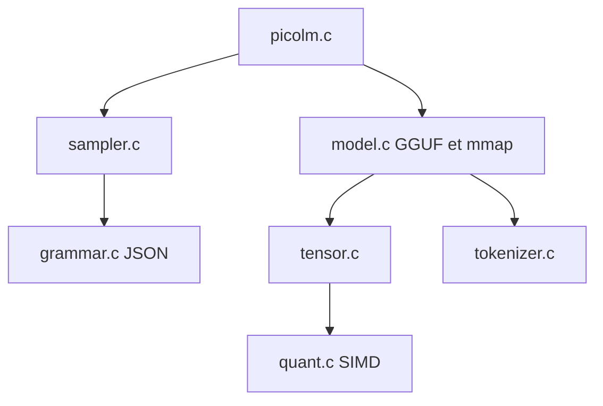

# RightNow-AI/picolm

> A pure C LLM inference engine, to run a one-billion-parameter model on a $10 board.

## The problem
Usual inference engines require hundreds of MB of memory and dependencies, which rules out small embedded boards.

## What it actually does
About 2,500 lines of C11 that read a GGUF file via mmap and walk through it layer by layer, with an FP16 KV cache, online-softmax attention, NEON and SSE2 kernels, and multithreaded matrix multiplication. The --json mode constrains output with a grammar for tool calls. The README claims about 45 MB of RAM and 10 tokens per second on a Pi 5. It serves as the local brain of the PicoClaw agent.

## How it is wired


## Trying it
```bash
git clone https://github.com/rightnow-ai/picolm.git
cd picolm/picolm
make native
make model
./picolm /opt/picolm/models/tinyllama-1.1b-chat-v1.0.Q4_K_M.gguf -p "The meaning of life is" -n 100
```

## Cost and gotchas
Free, no GPU, but the TinyLlama model weighs 638 MB and is slow on a Pi Zero (about 2 tokens per second). The ARM figures are marked as estimated.

## What it is not
Not a replacement for llama.cpp for large models or GPUs: support is limited to LLaMA-type models in GGUF. TinyLlama 1.1 billion gives simple answers. Last push in February 2026, a few days after creation.

## Alternatives
- llama.cpp: more complete but heavier, according to the README.

## For you
Worth watching: a good example of minimal inference for embedded use and for learning, but still very young and limited to small models.
