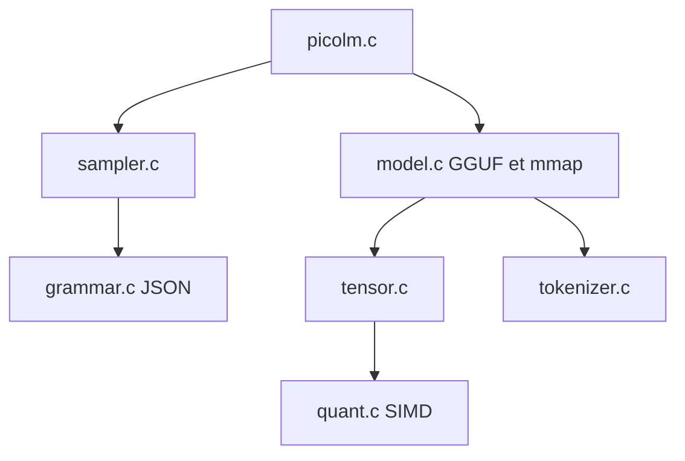

# RightNow-AI/picolm

> Un moteur d'inférence LLM en C pur, pour faire tourner un modèle d'un milliard de paramètres sur une carte à 10 dollars.

## Le problème
Les moteurs d'inférence usuels exigent des centaines de Mo de mémoire et des dépendances, ce qui exclut les petites cartes embarquées.

## Ce que ça fait vraiment
Environ 2 500 lignes de C11 qui lisent un fichier GGUF par mmap et le traversent couche par couche, avec cache KV en FP16, attention à softmax en ligne, noyaux NEON et SSE2, multiplication matricielle multithread. Le mode --json contraint la sortie par grammaire pour les appels d'outils. Le README annonce environ 45 Mo de RAM et 10 jetons par seconde sur Pi 5. Il sert de cerveau local à l'agent PicoClaw.

## Comment c'est branché


## Essayer
```bash
git clone https://github.com/rightnow-ai/picolm.git
cd picolm/picolm
make native
make model
./picolm /opt/picolm/models/tinyllama-1.1b-chat-v1.0.Q4_K_M.gguf -p "The meaning of life is" -n 100
```

## Coût et pièges
Gratuit, sans GPU, mais le modèle TinyLlama pèse 638 Mo et reste lent sur Pi Zero (environ 2 jetons par seconde). Les chiffres ARM sont marqués estimés.

## Ce que ce n'est pas
Pas un remplaçant de llama.cpp pour les gros modèles ou les GPU : le support se limite aux modèles de type LLaMA en GGUF. TinyLlama 1,1 milliard donne des réponses simples. Dernier push en février 2026, quelques jours après la création.

## Alternatives
- llama.cpp : plus complet mais plus lourd, selon le README.

## Pour toi
À surveiller : bon exemple d'inférence minimale pour l'embarqué et pour apprendre, mais encore très jeune et limité aux petits modèles.

