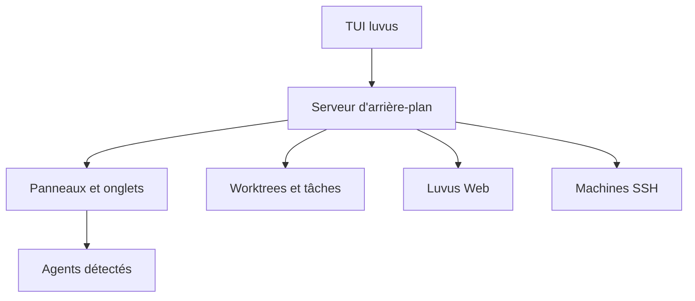

# RizRiyz/luvus

> Terminal multiplexer that tracks the state of several coding agents and orchestrates their workspaces.

## The problem
Running several coding agents in parallel makes you lose track of which one is working, waiting or blocked.

## What it actually does
Keeps persistent workspaces with tabs and panes, detects supported agents and shows their state, tokens and cost. Lets you send prompts to several panes, manage Git worktrees, task queues and connect to SSH machines. A read-only web client and a UHP protocol are provided.

## How it is wired
Simplified diagram based on the sheet, no diagram provided.


## Trying it
```sh
curl -fsSL https://luvus.dev/install.sh | sh
luvus
luvus doctor
luvus update
```

## Cost and gotchas
Free, but the cost of the agents you launch stays on you. Installation goes through a remote script. On macOS, you need to free up `Ctrl+Space`.

## What it is not
It is not an agent: it supervises others. The web client is not meant to be exposed without a trusted TLS tunnel.

## Alternatives
No alternative named in the README.

## For you
Keep an eye on it: useful if you run several coding agents in parallel and want to see their costs, but the project is young.
