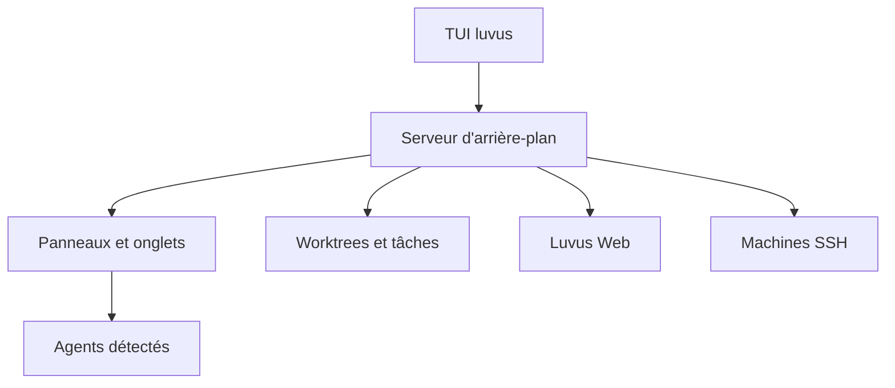

# RizRiyz/luvus

> Multiplexeur de terminal qui suit l'état de plusieurs agents de code et orchestre leurs espaces de travail.

## Le problème
Lancer plusieurs agents de code en parallèle fait perdre de vue lequel travaille, attend ou est bloqué.

## Ce que ça fait vraiment
Garde des espaces de travail persistants avec onglets et panneaux, détecte les agents pris en charge et affiche leur état, leurs jetons et leur coût. Permet d'envoyer des invites à plusieurs panneaux, de gérer des worktrees Git, des files de tâches et de se connecter à des machines SSH. Un client web en lecture seule et un protocole UHP sont fournis.

## Comment c'est branché
Schéma simplifié d'après la fiche, sans diagramme fourni.


## Essayer
```sh
curl -fsSL https://luvus.dev/install.sh | sh
luvus
luvus doctor
luvus update
```

## Coût et pièges
Gratuit, mais le coût des agents lancés reste à ta charge. L'installation passe par un script distant. Sur macOS, il faut libérer `Ctrl+Space`.

## Ce que ce n'est pas
Ce n'est pas un agent : il en supervise d'autres. Le client web n'est pas prévu pour être exposé sans tunnel TLS de confiance.

## Alternatives
Aucune alternative nommée dans le README.

## Pour toi
À surveiller : utile si tu lances plusieurs agents de code en parallèle et veux voir leurs coûts, mais le projet est jeune.

