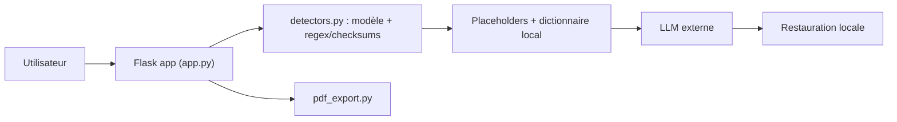

# Rizzo-AI-Academy/rizzo-pii

> Reversible personal-data anonymization model for Italian legal texts, running locally on CPU.

## The problem
Pasting contracts into ChatGPT or Claude sends names, tax codes and IBANs to a third party, which raises a GDPR concern.

## What it actually does
A ≈0.3B model (mmBERT) detecting 22 categories, including codice fiscale, P.IVA and land-registry data, coupled with regexes and checksums (IBAN, card, CF, PIVA). It replaces each value with a stable placeholder (`[FULLNAME_1]`), keeps the dictionary locally, then restores the LLM's response. Micro-F1 of 0.989 on real Italian validation data. A Tauri desktop app, a Flask API, and a PDF export that is truly redacted.

## How it is wired


## Trying it
```bash
git clone https://github.com/Rizzo-AI-Academy/rizzo-pii
cd rizzo-pii
docker build -t rizzo-pii .
docker run -d --name rizzo-pii -p 127.0.0.1:5005:5005 rizzo-pii
curl localhost:5005/health
```

## Cost and gotchas
CPU only, ~0.5–1.2 GB of RAM; Docker image of 2.65 GB. Italian-only validation, on short sentences; text inside a raster image cannot be redacted. Code is MIT, but the published binaries are under AGPL-3.0 (PyMuPDF).

## What it is not
Not a GDPR compliance guarantee on its own: the README recommends always keeping the regex/checksum safety net. The ORG and CITY labels are weaker.

## Alternatives
The README compares it with OpenAI Privacy Filter and Microsoft Presidio.

## For you
Adopt if you handle sensitive Italian documents before sending them to an LLM; for other languages, validation is missing.
