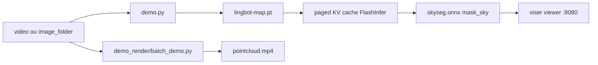

# Robbyant/lingbot-map

> Feed-forward model for streaming 3D reconstruction from a video.

## The problem
Reconstructing a 3D scene from a long video usually requires costly iterative optimization, and drift accumulates over thousands of frames.

## What it actually does
A "Geometric Context Transformer" unifies coordinate grounding, dense geometric cues and long-range drift correction through an anchor context, a reference pose window and a trajectory memory. Attention on a paged KV cache (FlashInfer) to sustain ~20 FPS at 518×378 on sequences of more than 10,000 frames. Two checkpoints published on Hugging Face and ModelScope. An offline rendering pipeline produces a point-cloud fly-through MP4.

## How it is wired


## Trying it
```bash
conda create -n lingbot-map python=3.10 -y
pip install torch==2.8.0 torchvision==0.23.0 --index-url https://download.pytorch.org/whl/cu128
pip install -e .
python demo.py --model_path /path/to/lingbot-map.pt --image_folder example/courthouse --mask_sky
```

## Cost and gotchas
NVIDIA GPU required, CUDA 12.8, PyTorch pinned to 2.8.0 because Kaolin has no wheel for 2.9. The rendering pipeline requires compiling two CUDA extensions and installing ffmpeg. Without FlashInfer, falls back to SDPA. Memory: `--offload_to_cpu` is on by default, `--num_scale_frames 2` reduces the peak.

## What it is not
Not a ready-to-use tool: the inference range is bounded by the distance seen during training, beyond that you must switch to `--mode windowed`. Training is not published, only inference. No license declared in the README.

## Alternatives
- VGGT: the bidirectional model whose stage-1 checkpoint can be loaded.
- DINOv2: upstream building block cited in the acknowledgments.

## For you
Out of scope for data/MLOps unless there is an explicit 3D project. Ignore.
