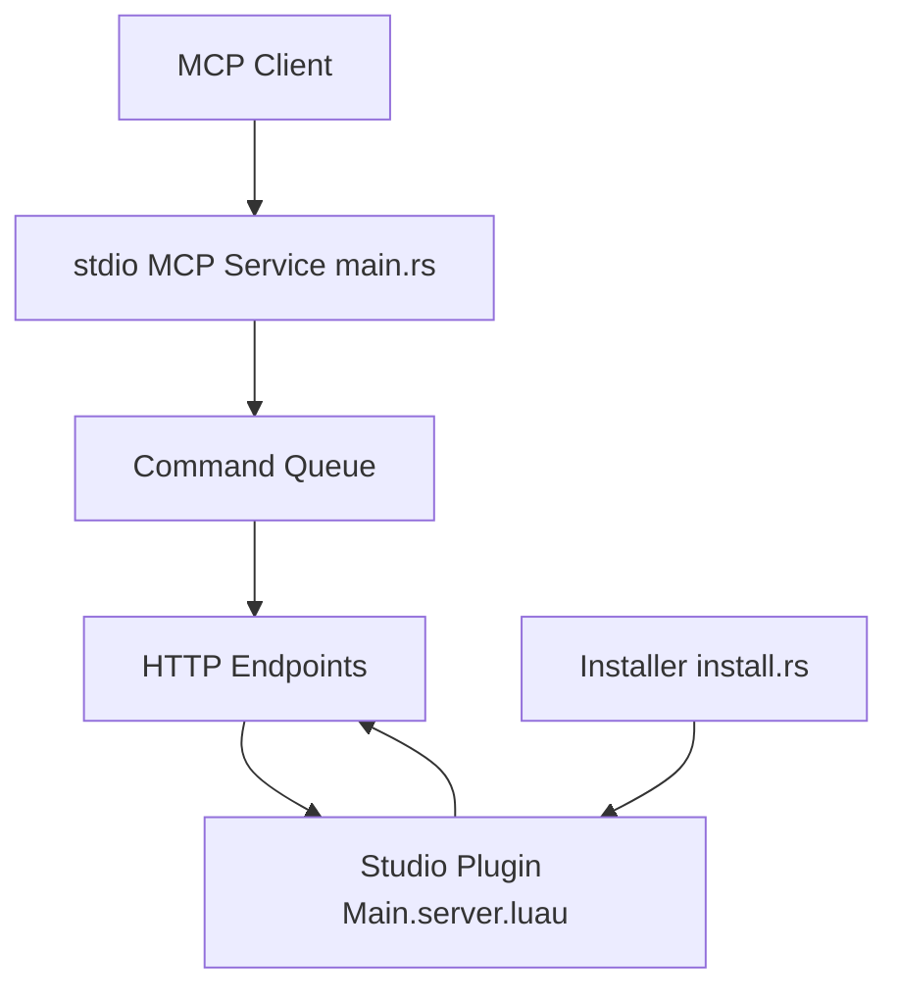

# Roblox/studio-rust-mcp-server

> Rust MCP server connecting Claude or Cursor to Roblox Studio; replaced by the built-in server.

## The problem
An AI assistant cannot read or modify a place open in Roblox Studio without a gateway.

## What it actually does
A Rust server exposes six MCP tools over stdio: `run_code`, `insert_model`, `get_console_output`, `start_stop_play`, `run_script_in_play_mode`, `get_studio_mode`. A Studio plugin long-polls a local HTTP server (axum) that queues the commands. An installer configures the plugin and the clients (Claude Desktop, Cursor).

## How it is wired



## Trying it
```bash
cargo run
claude mcp add --transport stdio Roblox_Studio -- '/Applications/RobloxStudioMCP.app/Contents/MacOS/rbx-studio-mcp' --stdio
```

## Cost and gotchas
Free. The server gives third-party tools read and write access to your open place. Archived, no longer under development.

## What it is not
No longer the recommended route: Roblox advises the MCP server built into Studio. It is only a reference implementation.

## Alternatives
The MCP server built into Roblox Studio, cited in the README warning.

## For you
Ignore: archived and tied to Roblox; use it only as an example of an MCP architecture with a long-polling plugin.
