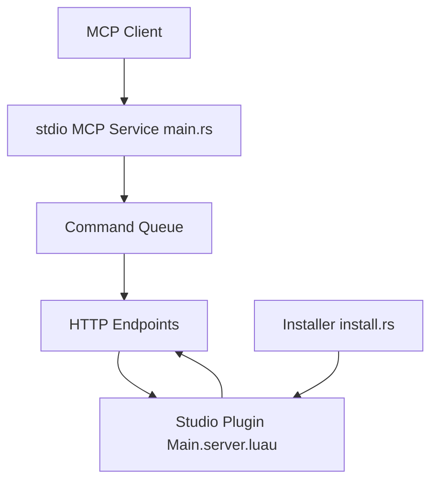

# Roblox/studio-rust-mcp-server

> Serveur MCP en Rust reliant Claude ou Cursor à Roblox Studio ; remplacé par le serveur intégré.

## Le problème
Un assistant IA ne peut pas lire ni modifier une place ouverte dans Roblox Studio sans passerelle.

## Ce que ça fait vraiment
Un serveur Rust expose six outils MCP en stdio : `run_code`, `insert_model`, `get_console_output`, `start_stop_play`, `run_script_in_play_mode`, `get_studio_mode`. Un plugin Studio interroge par long polling un serveur HTTP local (axum) qui met les commandes en file. Un installateur configure le plugin et les clients (Claude Desktop, Cursor).

## Comment c'est branché



## Essayer
```bash
cargo run
claude mcp add --transport stdio Roblox_Studio -- '/Applications/RobloxStudioMCP.app/Contents/MacOS/rbx-studio-mcp' --stdio
```

## Coût et pièges
Gratuit. Le serveur donne à des outils tiers un accès en lecture et en écriture à ta place ouverte. Archivé, ne reçoit plus de développement.

## Ce que ce n'est pas
Plus la voie recommandée : Roblox conseille le serveur MCP inclus dans Studio. Ce n'est qu'une implémentation de référence.

## Alternatives
Le serveur MCP intégré à Roblox Studio, cité dans l'avertissement du README.

## Pour toi
À ignorer : archivé et lié à Roblox ; sers-t'en seulement comme exemple d'architecture MCP avec plugin à long polling.

