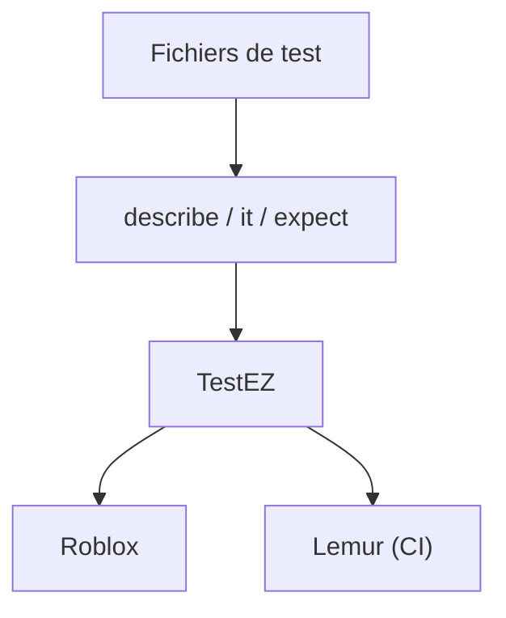

# Roblox/testez

> BDD-style Lua test framework for Roblox, runnable inside Roblox or in Lemur.

## The problem
Testing Roblox Lua code (apps, scripts, Studio plugins) with a readable syntax.

## What it actually does
`describe`, `it` and `expect` syntax, inspired by RSpec, busted, Mocha and Chai. One API runs all tests in a single call, another exposes each step. The README is short.

## How it is wired
Simplified diagram based on the sheet, no diagram provided.


## Trying it
```bash
# Aucune commande documentée dans le README.
```

## Cost and gotchas
Free. Archived, last push in March 2024. The real requirement is Roblox.

## What it is not
Not a general-purpose test framework: tied to Roblox Lua.

## Alternatives
No alternative named in the README.

## For you
Ignore: outside the data/AI scope, archived and poorly documented.
