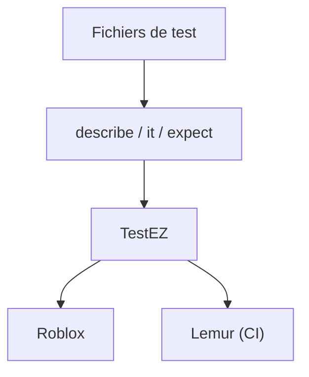

# Roblox/testez

> Framework de test Lua de style BDD pour Roblox, exécutable dans Roblox ou dans Lemur.

## Le problème
Tester du code Lua Roblox (apps, scripts, plugins Studio) avec une syntaxe lisible.

## Ce que ça fait vraiment
Syntaxe `describe`, `it` et `expect`, inspirée de RSpec, busted, Mocha et Chai. Une API lance tous les tests en un appel, une autre expose chaque étape. Le README est court.

## Comment c'est branché
Schéma simplifié d'après la fiche, sans diagramme fourni.


## Essayer
```bash
# Aucune commande documentée dans le README.
```

## Coût et pièges
Gratuit. Archivé, dernier push en mars 2024. Le besoin réel est Roblox.

## Ce que ce n'est pas
Pas un framework de test général : lié à Roblox Lua.

## Alternatives
Aucune alternative nommée dans le README.

## Pour toi
À ignorer : hors périmètre data/IA, archivé et peu documenté.

