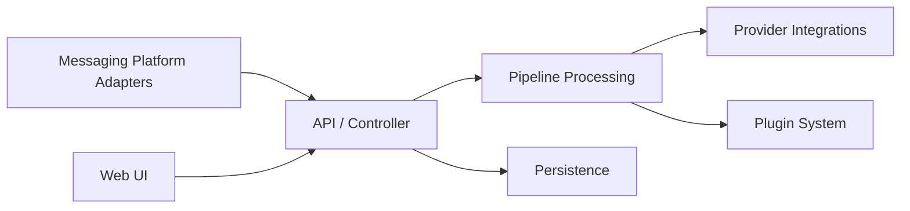

# RockChinQ/LangBot

> Platform to plug LLMs into Slack, Discord, Telegram, WeChat and other messaging apps, with a web panel.

## The problem
Connecting an agent or a Dify, n8n or Langflow flow to several messaging apps requires one adapter per platform.

## What it actually does
Platform adapters that normalize messages, a pipeline (sensitive-word filter, rate limiting, long text handling), model providers, a plugin system and an MCP server built in at `/mcp`. SQLite database by default, Vue.js admin panel. A public demo uses credentials displayed in the README.

## How it is wired


## Trying it
```bash
uvx langbot
git clone https://github.com/langbot-app/LangBot
cd LangBot/docker
docker compose --profile all up -d
```

## Cost and gotchas
Model keys are at your expense; a paid or freemium cloud version is possible (not detailed). The reference repository has changed (langbot-app/LangBot).

## What it is not
Not an agent framework: it connects agents and messaging apps.

## Alternatives
- Dify, Coze, n8n, Langflow: integrations cited as the flow engines behind the bot.

## For you
Keep an eye on it: useful if you need to expose an internal assistant in Slack or WeCom; off topic otherwise.
