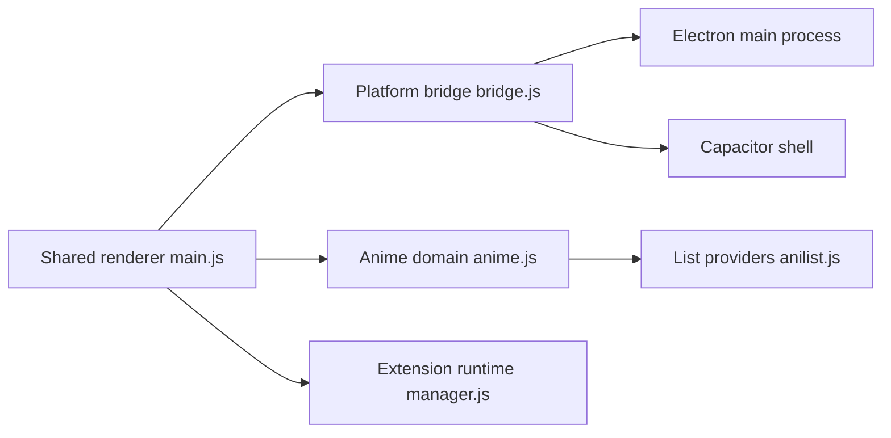

# RockinChaos/Shiru

> Anime library manager for desktop and Android, with AniList and MyAnimeList tracking.

## The problem
Tracking your anime, playing local files and knowing when subbed or dubbed episodes come out is scattered across several tools.

## What it actually does
A common Svelte interface runs under Electron (desktop) and Capacitor (Android). It plays local files without transcoding, syncs AniList and MyAnimeList lists, tracks sub and dub releases separately, sends notifications, and manages profiles and customizable shortcuts. Optional extensions add content sources. The README states that it hosts no media.

## How it is wired


## Trying it
```bash
winget install shiru
# ou, sous Arch :
paru -S shiru
```

## Cost and gotchas
Free. Building from source: Node 24.19.0, Java 21, Android Studio, Docker. The compiled APK is not signed.

## What it is not
Not a content provider. Extensions allow plugging in external sources: their legal use is left to the user.

## Alternatives
The README names no alternative.

## For you
Ignore: hobby application under GPL-3.0, unrelated to data, AI or MLOps work.
