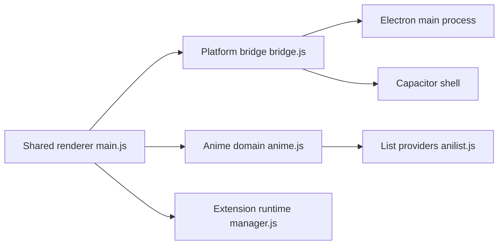

# RockinChaos/Shiru

> Gestionnaire de bibliothèque d'animés pour ordinateur et Android, avec suivi AniList et MyAnimeList.

## Le problème
Suivre ses animés, lire ses fichiers locaux et savoir quand sortent les épisodes sous-titrés ou doublés est dispersé sur plusieurs outils.

## Ce que ça fait vraiment
Une interface Svelte commune tourne sous Electron (bureau) et Capacitor (Android). Elle lit les fichiers locaux sans transcodage, synchronise les listes AniList et MyAnimeList, suit séparément les sorties VO et doublées, envoie des notifications, gère profils et raccourcis personnalisables. Des extensions optionnelles ajoutent des sources de contenu. Le README précise qu'elle n'héberge aucun média.

## Comment c'est branché


## Essayer
```bash
winget install shiru
# ou, sous Arch :
paru -S shiru
```

## Coût et pièges
Gratuit. Compilation depuis les sources : Node 24.19.0, Java 21, Android Studio, Docker. L'APK compilé n'est pas signé.

## Ce que ce n'est pas
Pas un fournisseur de contenu. Les extensions permettent de brancher des sources externes : leur usage légal est laissé à l'utilisateur.

## Alternatives
Le README ne nomme pas d'alternative.

## Pour toi
Ignorer : application de loisir sous GPL-3.0, sans rapport avec le travail data, IA ou MLOps.

