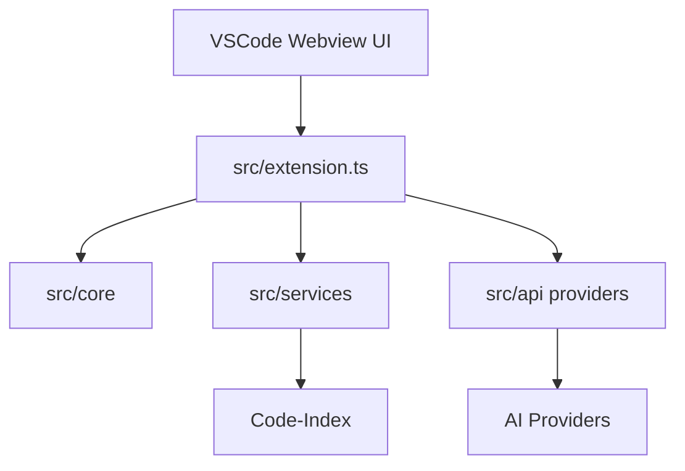

# RooCodeInc/Roo-Code

> Mode-based coding agent extension for VS Code, discontinued on May 15, 2026.

## The problem
Generating, refactoring and debugging code from the editor with a team of AI agents.

## What it actually does
Code, Architect, Ask, Debug and custom modes; MCP servers; calls to AI providers from the extension host. The monorepo also contains an evaluations service (Postgres, Docker), a code index (Qdrant) and Next.js applications. The README announces the end of the extension.

## How it is wired

## Trying it
No command documented in the README.

## Cost and gotchas
Models at your expense. Billing questions go through a given email contact. Repository archived.

## What it is not
It is no longer an active product: the README points to alternatives.

## Alternatives
ZooCode, a community fork of Roo, and Cline, from which Roo Code originated.

## For you
Ignore: discontinued; go straight to ZooCode or Cline.
