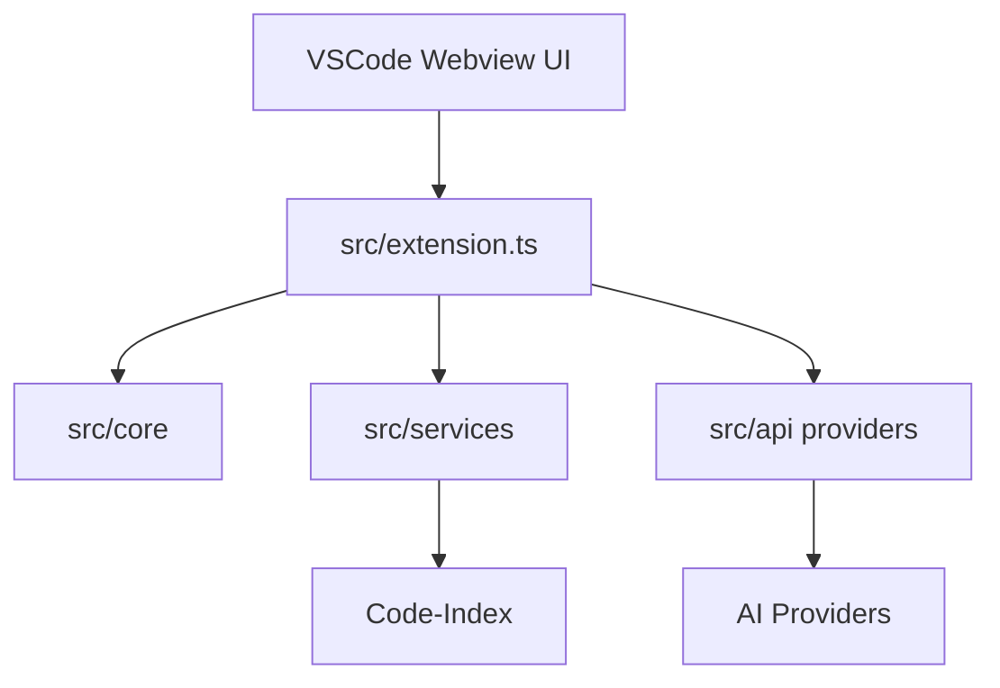

# RooCodeInc/Roo-Code

> Extension VS Code d'agents de code par modes, arrêtée le 15 mai 2026.

## Le problème
Générer, refactorer et déboguer du code depuis l'éditeur avec une équipe d'agents IA.

## Ce que ça fait vraiment
Modes Code, Architect, Ask, Debug et modes personnalisés ; serveurs MCP ; appels aux fournisseurs d'IA depuis l'hôte de l'extension. Le monorepo contient aussi un service d'évaluations (Postgres, Docker), un index de code (Qdrant) et des applications Next.js. Le README annonce l'arrêt de l'extension.

## Comment c'est branché

## Essayer
Aucune commande documentée dans le README.

## Coût et pièges
Modèles à ta charge. Les questions de facturation passent par un contact mail indiqué. Dépôt archivé.

## Ce que ce n'est pas
Ce n'est plus un produit actif : le README renvoie vers des alternatives.

## Alternatives
ZooCode, fork issu de la communauté Roo, et Cline, dont Roo Code est issu.

## Pour toi
À ignorer : arrêté ; passe directement à ZooCode ou Cline.

