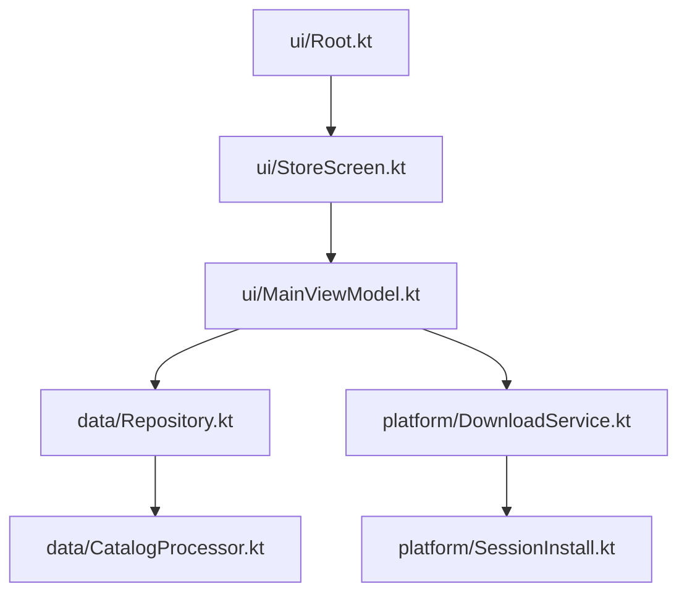

# RookieEnough/Orion-Store

> Native Android app store, built on public releases and inspectable metadata.

## The problem
Finding, installing and updating apps outside the Play Store without an opaque private service.

## What it actually does
Kotlin and Jetpack Compose client that reads a public JSON catalog and resolves releases on GitHub, GitLab and Codeberg. Downloads in a queue, detects the architecture, installs via the system, Shizuku or wireless ADB. App scanning (VirusTotal), permission and APK extraction tools, an AI assistant with your own key or a local model. The Orbit app tracking is inspired by Obtainium.

## How it is wired


## Trying it
```bash
./gradlew :app:assembleDebug
./gradlew :app:testDebugUnitTest
```
Normal installation: download the APK from the releases.

## Cost and gotchas
Free. Build with JDK 21 and the Android SDK. The author claims no data is collected; the Unity Ads kit of the optional quest is flagged by some scanners. The catalog and automations live in another repository.

## What it is not
Not a store without infrastructure: Cloudflare workers serve ranking, image proxy and submissions. Android only.

## Alternatives
- Obtainium: same idea of tracking from the release page; Orion does not reuse its code.

## For you
Ignore: an Android app store, unrelated to data, AI or MLOps work.
