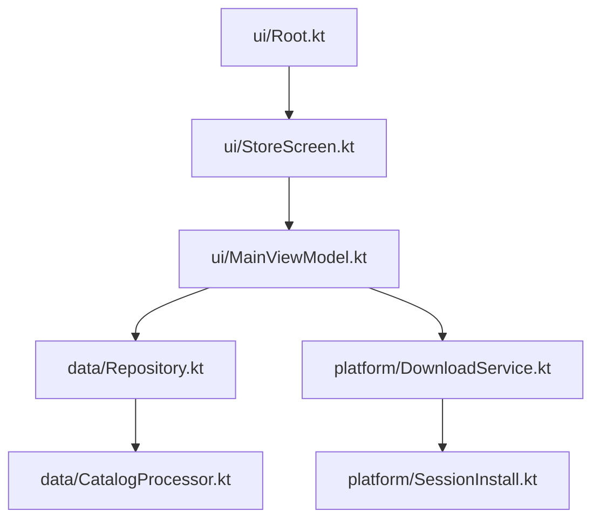

# RookieEnough/Orion-Store

> Magasin d'applications Android natif, construit sur des releases publiques et des métadonnées inspectables.

## Le problème
Trouver, installer et mettre à jour des applications hors Play Store sans service privé opaque.

## Ce que ça fait vraiment
Client Kotlin et Jetpack Compose qui lit un catalogue JSON public et résout les releases sur GitHub, GitLab et Codeberg. Télécharge en file, détecte l'architecture, installe via le système, Shizuku ou ADB sans fil. Analyse d'applications (VirusTotal), outils de permissions et d'extraction d'APK, assistant IA avec ta propre clé ou un modèle local. Le suivi d'applications Orbit s'inspire d'Obtainium.

## Comment c'est branché


## Essayer
```bash
./gradlew :app:assembleDebug
./gradlew :app:testDebugUnitTest
```
Installation normale : télécharger l'APK depuis les releases.

## Coût et pièges
Gratuit. Compilation avec JDK 21 et le SDK Android. L'auteur affirme qu'aucune donnée n'est collectée ; le kit Unity Ads de la quête optionnelle est signalé par certains scanners. Catalogue et automatisations vivent dans un autre dépôt.

## Ce que ce n'est pas
Pas un magasin sans infrastructure : des workers Cloudflare servent classement, proxy d'images et soumissions. Réservé à Android.

## Alternatives
- Obtainium : même idée de suivi depuis la page de publication ; Orion n'en reprend pas le code.

## Pour toi
À ignorer : magasin d'applications Android, sans rapport avec un travail data, IA ou MLOps.

