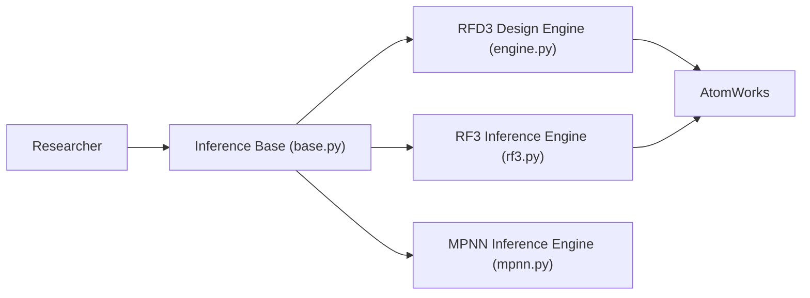

# RosettaCommons/foundry

> RosettaCommons toolkit for using and training protein design models (RFD3, RF3, ProteinMPNN).

## The problem
Protein design and folding models are scattered, with structure-processing tools that are incompatible with one another.

## What it actually does
Provides the shared infrastructure (inference, training, checkpoint registry) and four families of models: RFD3 and RFD3NA (all-atom design, nucleic acids included), RF3 (structure prediction) and ProteinMPNN/LigandMPNN (inverse folding). Everything relies on AtomWorks to handle structures. Also supports Intel XPU and Apple MPS (via a community fork).

## How it is wired


## Trying it
```bash
pip install "rc-foundry[all]"
foundry install base-models --checkpoint-dir <path/to/ckpt/dir>
foundry list-available
foundry list-installed
```

## Cost and gotchas
Free. Weights are downloaded separately (`~/.foundry/checkpoints` by default); the official Docker image includes them. The README states that tests are not supported for now. 88 open issues. On Mac, float32 precision and inference only.

## What it is not
Not a hosted service. The licenses of the model weights are not detailed in this README (the repository is BSD-3-Clause).

## Alternatives
No alternative named in the README.

## For you
Worth watching: a serious reference if you do protein design with ML; without that need, the field stays outside your scope.
