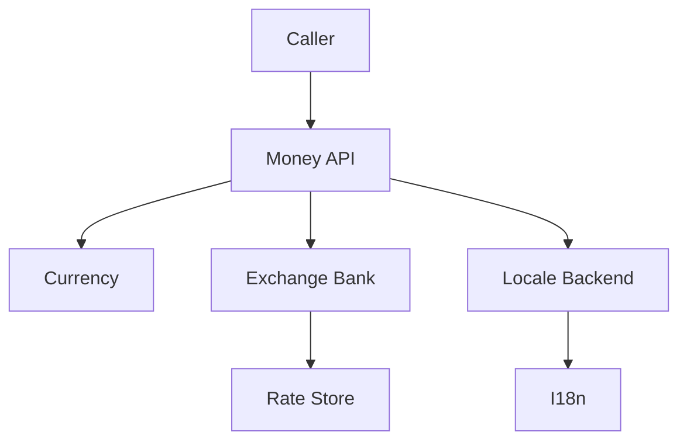

# RubyMoney/money

> Ruby library for handling amounts and currencies without floating-point rounding errors.

## The problem
Storing money as floats skews calculations; converting and formatting by currency is tedious.

## What it actually does
A `Money` class that stores integer cents, a `Money::Currency` class (ISO 4217), arithmetic, comparisons, conversion through an "exchange bank" of rates (in-memory by default, custom ActiveRecord or Redis stores), configurable rounding, and localized formatting via I18n. Third-party gems provide live rates.

## How it is wired
Diagram based on the code diagram.



## Trying it
```bash
gem install money
```
```ruby
require 'money'
Money.from_cents(1000, "USD").format  # => "$10.00"
```

## Cost and gotchas
Free, Ruby required (not listed in the prerequisites: put none). UTF-8 is mandatory. Exchange rates are not provided: you have to supply them yourself. The default localization behavior is deprecated.

## What it is not
Not a live exchange-rate client, nor a string parser (see monetize).

## Alternatives
monetize for parsing strings; money-rails for Rails.

## For you
Ignore: a Ruby library, unless you maintain a Ruby backend that handles currencies.
