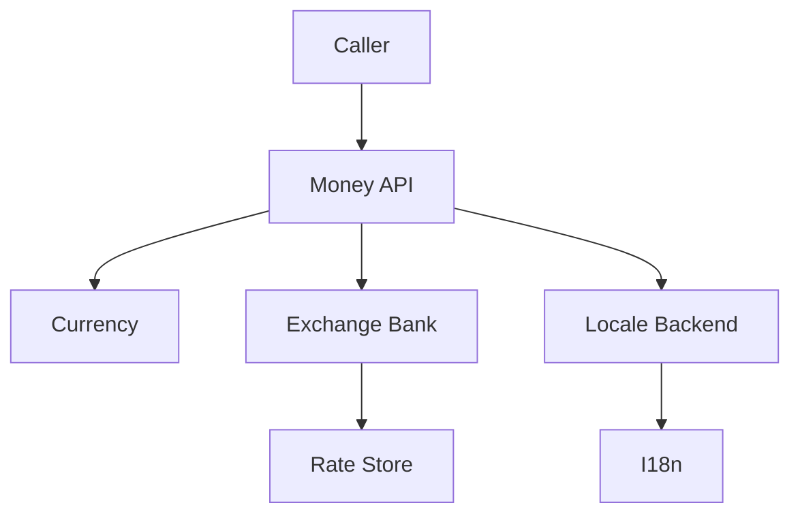

# RubyMoney/money

> Bibliothèque Ruby pour manipuler des montants et des devises sans erreur d'arrondi flottant.

## Le problème
Stocker de l'argent en flottants fausse les calculs ; convertir et formater selon la devise est fastidieux.

## Ce que ça fait vraiment
Classe `Money` qui stocke des entiers en cents, classe `Money::Currency` (ISO 4217), arithmétique, comparaisons, conversion via une « banque » de taux (mémoire par défaut, magasins personnalisés ActiveRecord ou Redis), arrondis configurables, formatage localisé via I18n. Des gems tiers fournissent les taux en ligne.

## Comment c'est branché
Schéma d'après le diagramme du code.



## Essayer
```bash
gem install money
```
```ruby
require 'money'
Money.from_cents(1000, "USD").format  # => "$10.00"
```

## Coût et pièges
Gratuit, Ruby requis (non listé dans les prérequis : mettre aucun). UTF-8 obligatoire. Les taux de change ne sont pas fournis : à toi de les alimenter. Le comportement de localisation par défaut est déprécié.

## Ce que ce n'est pas
Pas un client de taux de change en direct, ni un analyseur de chaînes (voir monetize).

## Alternatives
monetize pour parser des chaînes ; money-rails pour Rails.

## Pour toi
À ignorer : bibliothèque Ruby, sauf si tu maintiens un backend Ruby manipulant des devises.

