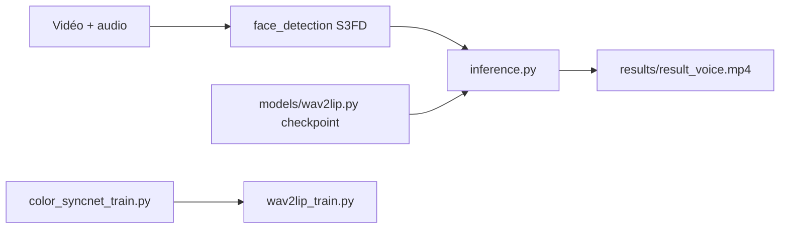

# Rudrabha/Wav2Lip

> Video lip-sync model for any audio, as a non-commercial research release.

## The problem
Aligning the lips of a filmed face to arbitrary audio is hard and holds up poorly in real-world conditions.

## What it actually does
The README opens with a commercial version (Sync API, `lipsync-2` model, Python and TypeScript SDK, API key). The open source code is separate: `inference.py` takes a face video, an audio file and a checkpoint, detects the face (S3FD) and produces the synchronized video. Training happens in two stages (SyncNet expert, then Wav2Lip, with or without a quality discriminator) on LRS2.

## How it is wired


## Trying it
```bash
pip install -r requirements.txt
python inference.py --checkpoint_path <ckpt> --face <video.mp4> --audio <an-audio-source>
```

## Cost and gotchas
Python 3.6, ffmpeg, weights to download. Strictly non-commercial use (trained on LRS2); the repository declares no license. The quality version is a paid service with an API key. Last push on 2025-06-22.

## What it is not
Not free for commercial use. The README itself says the commercial version is of much better quality than the old open source model.

## Alternatives
Sync API (sync.so), the hosted commercial version from the same authors.

## For you
Worth watching: a research reference for lip-sync, but unusable in production without a commercial contract, and dated.
