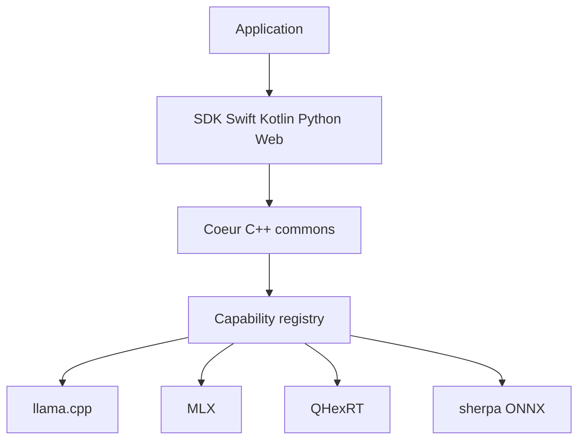

# RunanywhereAI/runanywhere-sdks

> Eight SDKs on top of a C++ core to run LLM, voice and vision on-device, for mobile and embedded developers.

## The problem
Running a model locally on iOS, Android, the browser and desktop forces you to rewrite the integration for every engine and every chip.

## What it actually does
A C++ core behind a C interface exposes LLM, VLM, STT, TTS, embeddings, RAG and structured output. A capability registry picks the engine (QHexRT on Qualcomm NPUs, MLX on Apple, llama.cpp, sherpa+ONNX, Core ML). Statuses vary: Swift and Kotlin are "stable", Flutter/RN/Web "beta", Python "alpha". An optional console manages a fleet of devices.

## How it is wired


## Trying it
```bash
pip install runanywhere
```
```python
import runanywhere as ra
from runanywhere import LlmOptions
ra.initialize()
print(ra.llm.generate("Explain on-device AI in one sentence.",
                      LlmOptions(model="qwen2.5-0.5b")).text)
```

## Cost and gotchas
Free; models are downloaded on first use. Console and telemetry are optional (API key). QHexRT only runs on Snapdragon Hexagon. The LAN "Connect" mode has no TLS and no authentication.

## What it is not
Not an autonomous agent (the CUA is only an action parser). No wake word. Several Python functions are stubs. The license file exists but GitHub does not identify it: read it before use. The README provided is cut off at the end.

## Alternatives
- Cactus: hybrid edge-cloud engine for mobile, cited in the batch catalog.
- llama.cpp: the underlying engine, lower level.

## For you
Worth watching if you deploy embedded AI on mobile: the single API is useful, but the license needs clarifying and the Python SDK is still alpha.
