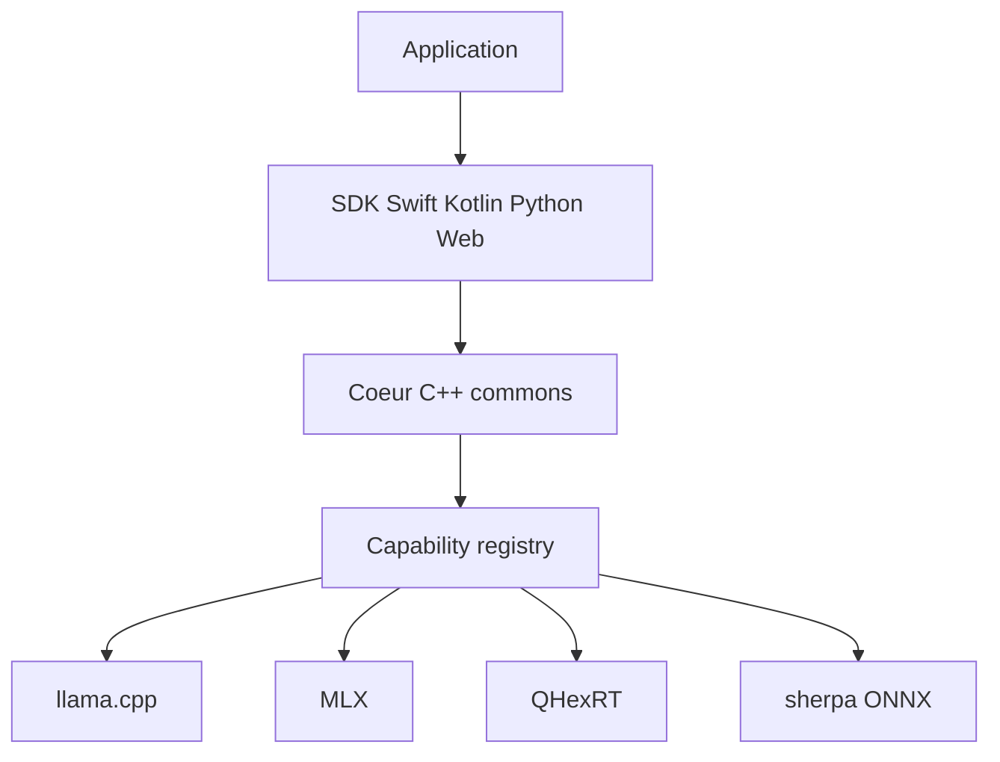

# RunanywhereAI/runanywhere-sdks

> Huit SDK au-dessus d'un cœur C++ pour exécuter LLM, voix et vision sur l'appareil, pour développeurs mobile et embarqué.

## Le problème
Faire tourner un modèle en local sur iOS, Android, navigateur et desktop oblige à réécrire l'intégration pour chaque moteur et chaque puce.

## Ce que ça fait vraiment
Un cœur C++ derrière une interface C expose LLM, VLM, STT, TTS, embeddings, RAG et sortie structurée. Un registre de capacités choisit le moteur (QHexRT sur NPU Qualcomm, MLX sur Apple, llama.cpp, sherpa+ONNX, Core ML). Statuts variables : Swift et Kotlin « stable », Flutter/RN/Web « beta », Python « alpha ». Une console optionnelle gère un parc d'appareils.

## Comment c'est branché


## Essayer
```bash
pip install runanywhere
```
```python
import runanywhere as ra
from runanywhere import LlmOptions
ra.initialize()
print(ra.llm.generate("Explain on-device AI in one sentence.",
                      LlmOptions(model="qwen2.5-0.5b")).text)
```

## Coût et pièges
Gratuit ; les modèles se téléchargent à la première utilisation. Console et télémétrie optionnelles (clé d'API). QHexRT ne tourne que sur Snapdragon Hexagon. Le mode « Connect » LAN n'a ni TLS ni authentification.

## Ce que ce n'est pas
Pas un agent autonome (le CUA n'est qu'un parseur d'actions). Pas de wake word. Plusieurs fonctions Python sont des « stub ». Le fichier de licence existe mais GitHub ne l'identifie pas : à lire avant usage. Le README fourni est coupé en fin de texte.

## Alternatives
- Cactus : moteur hybride edge-cloud pour mobile, cité dans le catalogue du lot.
- llama.cpp : le moteur sous-jacent, plus bas niveau.

## Pour toi
À surveiller si tu déploies de l'IA embarquée sur mobile : l'API unique est utile, mais la licence est à clarifier et le SDK Python reste alpha.

