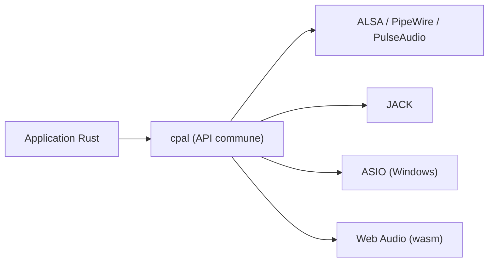

# RustAudio/cpal

> Low-level cross-platform Rust audio input and output library, for audio application developers.

## The problem
Each system (ALSA, JACK, CoreAudio, ASIO, Web Audio) exposes a different audio interface.

## What it actually does
Offers a common API to enumerate devices and open audio streams for capture and playback. Optional backends: ASIO, JACK, PipeWire, PulseAudio, WebAssembly (`wasm-bindgen`, `audioworklet`), Android, and a `custom` mode. `realtime` option for real-time priority.

## How it is wired
Simplified diagram based on the sheet, no diagram provided.



## Trying it
```sh
cargo run --example beep
cargo run --example beep --features pipewire
```

## Cost and gotchas
Free. On Linux, ALSA (`libasound2-dev`) is required even with JACK, PipeWire or PulseAudio. ASIO requires LLVM/Clang and the ASIO SDK. Buffer sizes that are too large disrupt playback.

## What it is not
Not a high-level playback library: the README points to Rodio. It does not compose duplex devices itself.

## Alternatives
- Rodio: higher-level playback and capture.

## For you
Ignore: a low-level Rust audio building block, useful only if you write an audio application or an audio inference engine in Rust.
