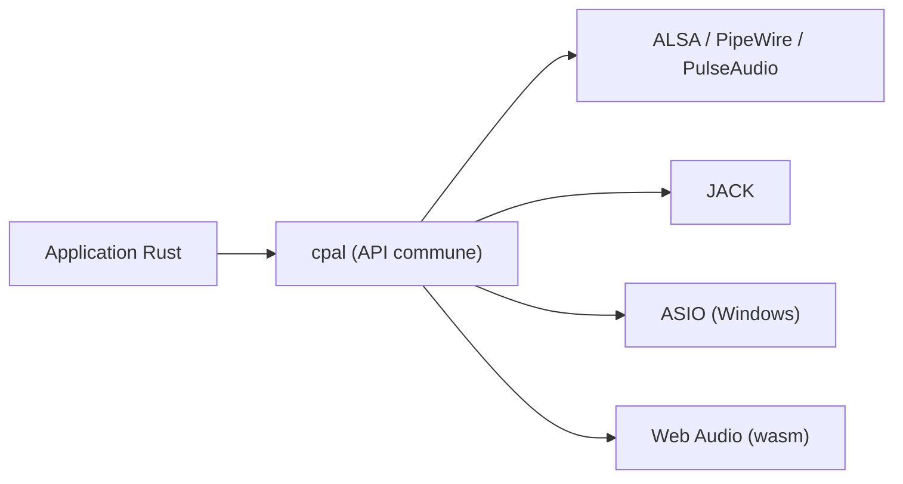

# RustAudio/cpal

> Bibliothèque Rust bas niveau d'entrée et sortie audio multiplateforme, pour développeurs d'applications audio.

## Le problème
Chaque système (ALSA, JACK, CoreAudio, ASIO, Web Audio) expose une interface audio différente.

## Ce que ça fait vraiment
Offre une API commune pour énumérer les périphériques et ouvrir des flux audio en capture et lecture. Backends optionnels : ASIO, JACK, PipeWire, PulseAudio, WebAssembly (`wasm-bindgen`, `audioworklet`), Android, et un mode `custom`. Option `realtime` pour la priorité temps réel.

## Comment c'est branché
Schéma simplifié d'après la fiche, sans diagramme fourni.



## Essayer
```sh
cargo run --example beep
cargo run --example beep --features pipewire
```

## Coût et pièges
Gratuit. Sous Linux, ALSA (`libasound2-dev`) est requis même avec JACK, PipeWire ou PulseAudio. ASIO exige LLVM/Clang et le SDK ASIO. Des tailles de tampon trop grandes dérèglent la lecture.

## Ce que ce n'est pas
Ce n'est pas une bibliothèque de lecture haut niveau : le README renvoie vers Rodio. Il ne compose pas lui-même des périphériques duplex.

## Alternatives
- Rodio : lecture et capture de plus haut niveau.

## Pour toi
À ignorer : brique audio Rust bas niveau, utile seulement si tu écris une application audio ou un moteur d'inférence audio en Rust.

