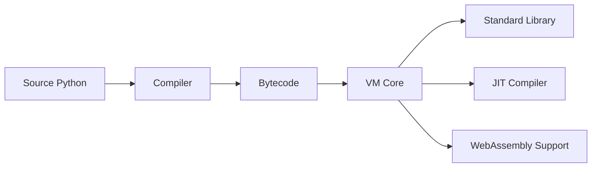

# RustPython/RustPython

> Python 3 interpreter written in Rust, embeddable or compilable to WebAssembly.

## The problem
Running or embedding Python in a Rust application or in WebAssembly without linking CPython.

## What it actually does
A compiler to bytecode followed by a virtual machine in Rust, with a stdlib mixing `Lib/` (Python) and native Rust modules. Options: a "very experimental" JIT compiler (`__jit__()`), a WASI target, SSL (rustls or OpenSSL), pip installation. The README itself states it is not ready for production.

## How it is wired


## Trying it
```bash
git clone https://github.com/RustPython/RustPython
cd RustPython
cargo run --release -- -c 'print("Hello, RustPython!")'
```

## Cost and gotchas
Stable Rust required, long compilation; the JIT needs autoconf, automake, libtool and clang; OpenSSL or a C compiler for SSL; symlinks on Windows.

## What it is not
Not a CPython replacement for production: the scientific ecosystem (NumPy, etc.) is not advertised.

## Alternatives
None named in the README (pythonvm-rust and rspython are cited as links).

## For you
Keep an eye on it: nice for embedding Python in Rust or on the web, but unusable for your data stack as long as C libraries are missing.
