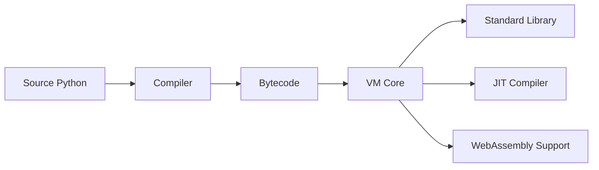

# RustPython/RustPython

> Interpréteur Python 3 écrit en Rust, embarquable ou compilable en WebAssembly.

## Le problème
Exécuter ou embarquer du Python dans une appli Rust ou dans WebAssembly sans lier CPython.

## Ce que ça fait vraiment
Compilateur vers bytecode puis machine virtuelle en Rust, avec stdlib mêlant `Lib/` (Python) et modules natifs Rust. Options : compilateur JIT « très expérimental » (`__jit__()`), cible WASI, SSL (rustls ou OpenSSL), installation de pip. Le README annonce lui-même qu'il n'est pas prêt pour la production.

## Comment c'est branché


## Essayer
```bash
git clone https://github.com/RustPython/RustPython
cd RustPython
cargo run --release -- -c 'print("Hello, RustPython!")'
```

## Coût et pièges
Rust stable requis, compilation longue ; JIT demande autoconf, automake, libtool et clang ; OpenSSL ou compilateur C pour SSL ; symlinks sous Windows.

## Ce que ce n'est pas
Pas un remplaçant de CPython pour la prod : écosystème scientifique (NumPy, etc.) non annoncé.

## Alternatives
Aucune nommée dans le README (pythonvm-rust et rspython sont cités comme liens).

## Pour toi
Surveiller : sympathique pour embarquer du Python dans du Rust ou le web, mais inutilisable pour ton stack data tant que les bibliothèques C manquent.

